<div align="center">


# Void OS

**Your home server in one browser tab.** Files, apps, a terminal, remote access, cloud sync and an intercom — on a Raspberry Pi, any Linux box, macOS or Windows.

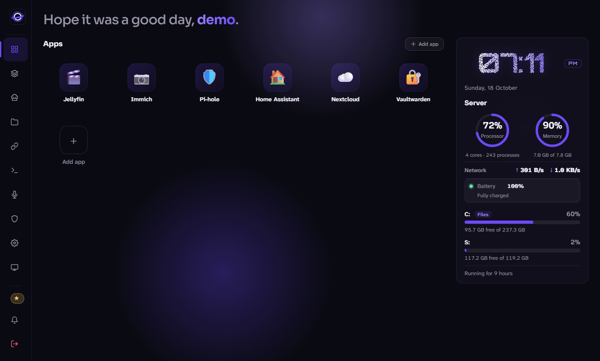

<sub>The Architect &mdash; <a href="https://github.com/Ishaan1313">corruptedarc</a></sub>

</div>

> This repository holds the **releases and installers** of Void OS. Installs update themselves from here; the source is private.

---

## ⚡ Install in one line

One file per system. It downloads Void OS, installs everything it needs and sets it up (service, `voidos` command, first-run wizard).

**🐧 Linux · 🍓 Raspberry Pi · 🍎 macOS**
```bash
curl -fsSL https://raw.githubusercontent.com/Ishaan1313/voidos-releases/main/install.sh | bash
```

**🪟 Windows 10 / 11** (PowerShell)
```powershell
irm https://raw.githubusercontent.com/Ishaan1313/voidos-releases/main/install.ps1 | iex
```

When it finishes it prints the address to open (`http://localhost:7777`). Create your account there: **the first account becomes the Super User, so do it right away.**
Run the same line again any time to refresh the program files; your `.env` and data are kept.

<details>
<summary>⚙️ Options (port, folders, unattended, another install folder)</summary>

```bash
# Linux / macOS: options go after "bash -s --"
curl -fsSL https://raw.githubusercontent.com/Ishaan1313/voidos-releases/main/install.sh | bash -s -- --yes --port 8080
VOIDOS_DIR=/opt/voidos curl -fsSL https://raw.githubusercontent.com/Ishaan1313/voidos-releases/main/install.sh | bash
```
```powershell
# Windows: set variables first
$env:VOIDOS_YES = '1'               # no questions
$env:VOIDOS_DIR = 'D:\voidos'       # another install folder
irm https://raw.githubusercontent.com/Ishaan1313/voidos-releases/main/install.ps1 | iex
```
Every option is listed by `bash "scripts/install.sh" --help` / `.\install.ps1 -Help`.
</details>

---

## 📸 A look around

<table>
<tr>
<td width="50%">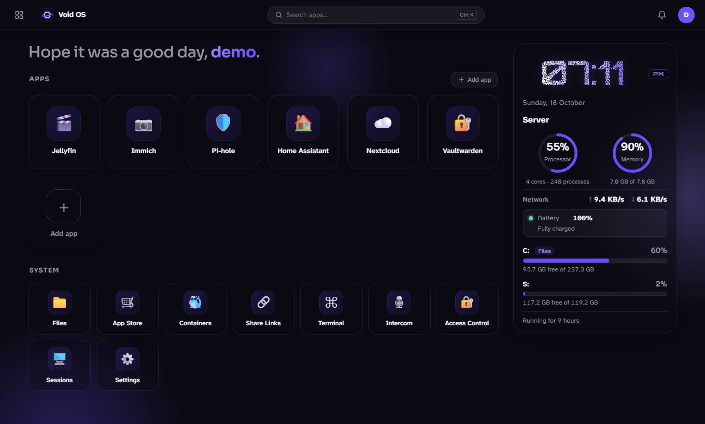<br><sub>🏠 <b>Home screen</b> — launcher, search, live server stats and a particle clock</sub></td>
<td width="50%">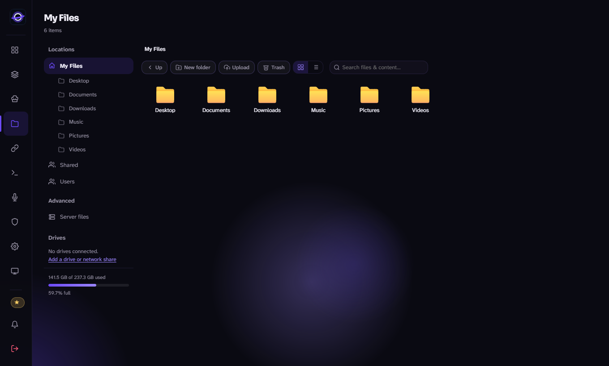<br><sub>📁 <b>Files</b> — resumable uploads, share links, Recycle Bin, WebDAV, drives</sub></td>
</tr>
<tr>
<td>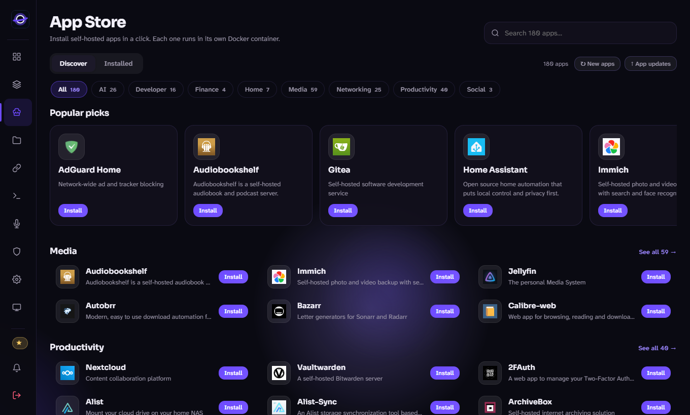<br><sub>🛍️ <b>App Store</b> — 180 apps, one click each, previewed before install</sub></td>
<td>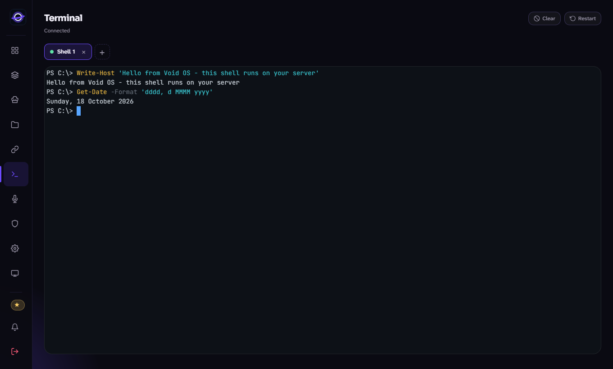<br><sub>💻 <b>Terminal</b> — real shells in the browser, several tabs, kept running between pages</sub></td>
</tr>
<tr>
<td>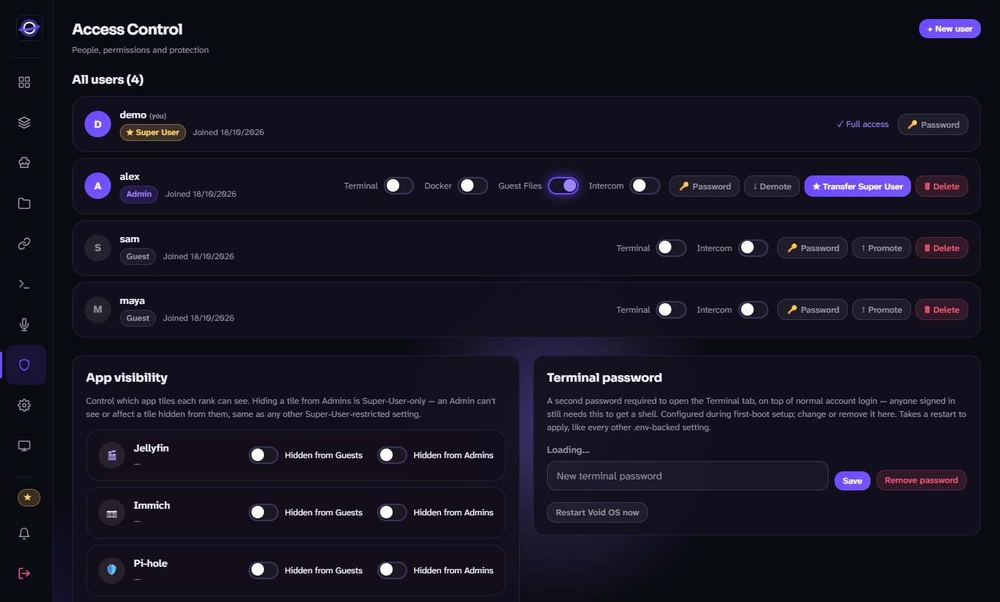<br><sub>👥 <b>People</b> — Super User, Admin and Guest ranks, switches that act instantly</sub></td>
<td>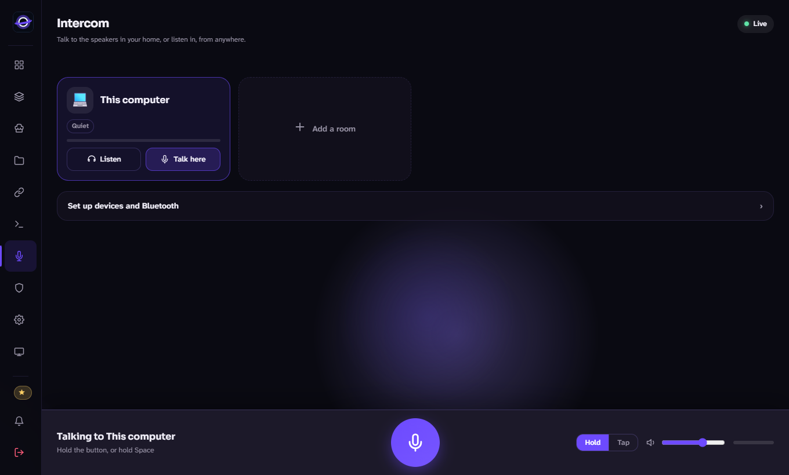<br><sub>🎙️ <b>Intercom</b> — talk to speakers and microphones on the server, Bluetooth too</sub></td>
</tr>
</table>

### 🎨 Five themes

<table>
<tr>
<td>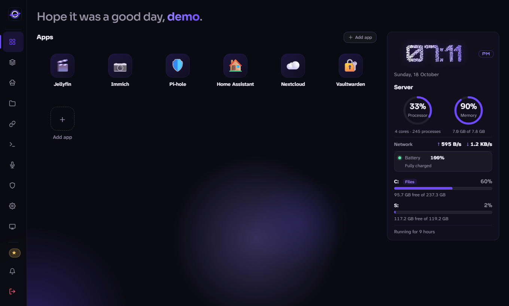<br><sub>Void</sub></td>
<td>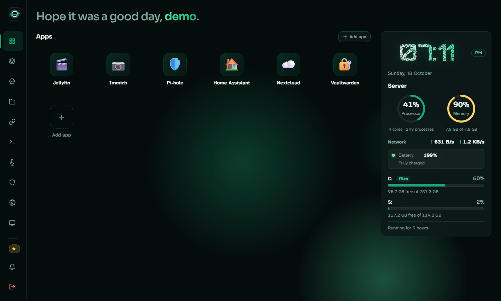<br><sub>Emerald</sub></td>
</tr>
<tr>
<td>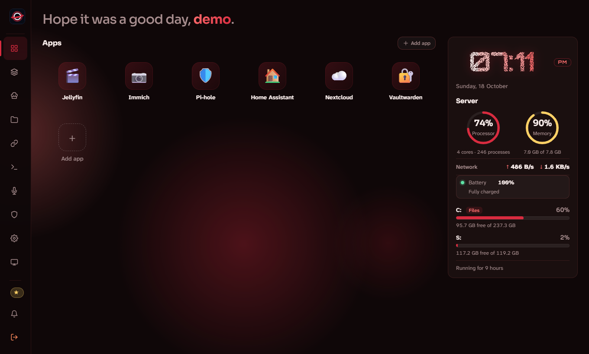<br><sub>Crimson</sub></td>
<td>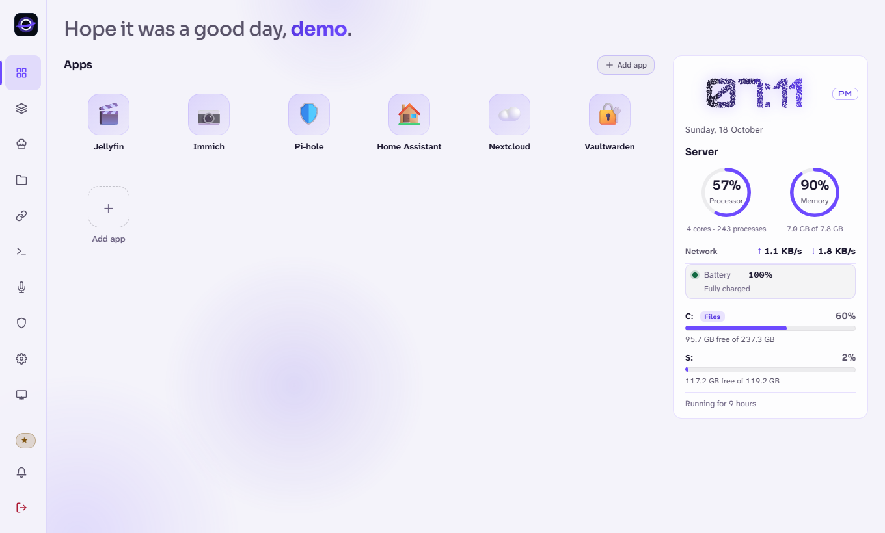<br><sub>Light</sub></td>
</tr>
</table>

<sub>Plus <b>Horizon</b> (blue); <b>Void</b> (purple) is the default. Pick yours in <i>Settings → Appearance</i>.</sub>

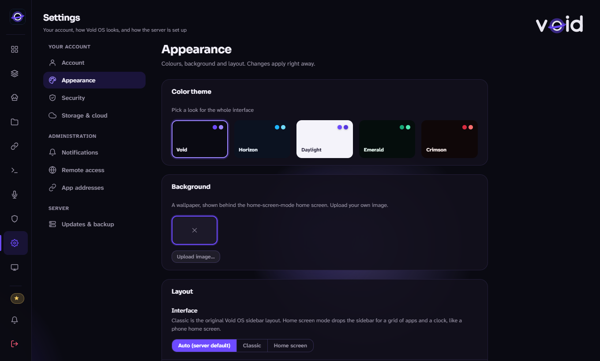

---

## ✨ What you get

| | |
|---|---|
| 📁 **Files** | Browse, upload any size (resumable), share links with PINs, Recycle Bin, search, WebDAV network drive, USB drives and SMB/NFS shares |
| 🛍️ **Apps** | A 180-app Docker App Store (refreshable without updating Void OS), dashboard tiles, container management |
| 🌍 **Remote access** | A built-in Cloudflare Quick Tunnel (no account, no open ports), a separate tunnel per app, a PIN gate in front of tunneled apps |
| 💻 **Terminal** | Real shells in the browser, as many tabs as you like |
| ☁️ **Cloud** | Dropbox and Google Drive: browse, import, export, continuous two-way sync |
| 🎙️ **Intercom** | Talk to, or listen through, named rooms (speakers and microphones on the server, Bluetooth or not) from anywhere |
| 👥 **People** | Super User, Admin and Guest ranks, per-permission switches that take effect instantly, sessions, activity log, guest quotas, optional two-factor sign-in |
| 🎨 **Interface** | Classic (sidebar) or a home screen, five themes, wallpapers |
| 🔔 **Notifications** | An in-app bell plus email, Discord and Telegram |
| 🔄 **Updates** | One click from GitHub releases; app list refreshable on its own |

---

## ⚖️ Core rule: changes are enforced instantly

Whatever one person changes for another takes effect **immediately** — not at the next page load, next login or next restart. This applies to every setting that can affect other users, and to everything already running when the change is made:

- 🚪 **Revoking a session** ends that device's terminal, intercom call and page within a second, and the page is sent to the sign-in screen. A session that disappears by any other route is swept within seconds.
- 🎚️ **Changing a rank or a permission** (Terminal, Docker, Intercom, full file access, promote, demote, delete, Super User transfer, 2FA reset, password reset) updates the person's open page at once: navigation, buttons and pages appear or vanish without a reload. Access they lost is cut on the spot: a live terminal or call is closed, and copies and zips they started stop.
- 📡 **Shared things** (tiles, drives and network shares, the server-wide interface default, the user list) are pushed to every open page that shows them.
- 🔗 **Share links** stop working the moment they are revoked, even for a visitor who already unlocked them.
- 🛟 If a push is ever missed (a dropped tunnel, a sleeping laptop) the page re-checks its own access when it reconnects, when the tab is shown again and every 10 seconds.

New features follow the same rule: enforce on the server at the moment of the change, push it to open pages, and cancel work that depends on the old access (the hooks are in `modules/web.py`).

---

## 📑 Contents

0. [Install in one line](#-install-in-one-line)
1. [Install in detail](#-install-in-detail)
2. [First run](#-first-run)
3. [Using Void OS](#-using-void-os) — interface, files, apps, terminal
4. [Cloud storage](#-cloud-storage)
5. [External storage](#-external-storage)
6. [Intercom](#-intercom)
7. [Remote access](#-remote-access)
8. [Users and permissions](#-users-and-permissions) — including [two-factor sign-in](#two-factor-sign-in)
9. [Photos](#-photos)
10. [Chat](#-chat)
11. [Notifications](#-notifications)
12. [Configuration](#-configuration)
13. [Updates](#-updates)
14. [Backup and restore](#-backup-and-restore)
15. [Troubleshooting](#-troubleshooting)
16. [Platform notes](#-platform-notes)
17. [Security](#-security)

---

## 📦 Install in detail

**Needs:** Python 3.10 or newer (the installer fetches it if it's missing), about 1 GB of RAM, and Docker only if you want the App Store. Works on Raspberry Pi OS, Debian, Ubuntu, Fedora/RHEL, Arch, openSUSE, Alpine, macOS and Windows 10/11.

### From a downloaded copy

Download or clone the repository, then from inside its folder:

```bash
bash "scripts/install.sh"                 # Linux, Raspberry Pi, macOS
```
On Windows, double-click **`scripts\install.cmd`** (it runs `install.ps1` beside it).

The installer asks a few questions up front (port, files folder, optional features), then runs on its own. It checks the system, finds or installs Python, installs Void OS's packages into a private `.venv/` folder, installs the tools for any optional features you picked, creates your `.env` with a fresh secret key, sets Void OS to start automatically (a systemd service, launchd on macOS, or a Startup shortcut on Windows), starts it, and prints the address to open. It needs administrator rights, because it installs system packages and a service: on Linux it re-runs itself with `sudo` (or start it that way), and on Windows it asks for the UAC prompt and continues in an elevated window. Void OS itself still runs as your own account, not as root. Everything is logged to `install.log`.

Useful options:

```bash
bash "scripts/install.sh" --yes                               # no questions, defaults
bash "scripts/install.sh" --port 8080 --file-root /media/STORAGE
bash "scripts/install.sh" --with tunnel,sync --without docker
bash "scripts/install.sh" --private-python                    # isolated Python even if the system has one
bash "scripts/install.sh" --no-service --no-start
bash "scripts/install.sh" --uninstall
```
```powershell
"scripts\install.cmd" -Yes
"scripts\install.cmd" -Port 8080 -FileRoot D:\VoidFiles -With tunnel,sync
"scripts\install.cmd" -Uninstall
```

On Linux and macOS the installer sets up **everything** Void OS can use by default (Docker, USB and network-share tools, cloudflared and Node for remote access, rclone, and Bluetooth/PipeWire audio), so nothing is missing later; use `--without` to skip any. Installing cloudflared does not switch the public tunnel on. The password-less mount rule is the one thing that stays off unless you ask for it (`--with mount`).

It also installs a **`voidos`** command:

```bash
voidos start        # start it           voidos logs        # last 100 lines, then follow live
voidos stop         # stop it            voidos logs 500    # the last 500 lines
voidos restart      # after editing .env voidos status      # running? where?
voidos config       # edit .env          voidos enable|disable   # start at boot or not
voidos update       # re-run the installer (keeps your data)
```

`voidos logs` tidies the output: a time column, messages lined up, warnings in
yellow, errors and tracebacks in red, systemd's own notes dimmed. `voidos logs
--raw` shows the untouched journal. Use `voidos logs`, not `journalctl` directly:
the journal's own lines carry the date, the host name and the process id on every
line, which is what made the output hard to read.

One request is one line, with the columns lined up and the address last, and the
status number coloured (green 2xx, cyan 3xx, yellow 4xx, red 5xx):

```
14:47:03  200  GET       771 B     3 ms  /api/stats
14:47:03  404  GET       146 B     1 ms  /api/nothing
14:47:04  500  POST         -    12 ms  /api/boom
```

The referrer and the browser's name are no longer written (they made every line wrap
three times over), and each line is printed once (Gunicorn used to print every request
twice). The `voidos` command is copied to `/usr/local/bin` by the installer; Void OS now
renews that copy by itself a little after it starts whenever the one in `scripts/` is
newer, so an update brings the newest `voidos logs` too. If it isn't allowed to write
there (root owns the folder and there is no passwordless `sudo`) it prints the one
`sudo install ...` command to run by hand.

After you create the first account, a **setup wizard** asks for every setting in `.env` (basics first, then one optional step per group of advanced settings, then a review). Anything left alone keeps its default.

Re-running the installer is safe: it keeps your `.env` and all data. Uninstalling removes the service and the Python environment but keeps your files, `.env` and Void OS's data. The `scripts` folder holds the installers and `.env.example`; leave it in place.

### First account, and what protects it

The first account becomes the Super User, and it is created by whoever opens the page first.
Create it straight after installing, before the address is shared.

A few rules worth knowing:

- **Void OS's own files are never reachable from Files, WebDAV, share links or search.**
  This matters when the files folder contains the app folder (older installs used the whole
  home folder): without it an Admin could read the secret key and edit `users.json`.
- **Elevated host access is the Super User's call.** An app that wants the Docker socket, a
  privileged container or a host mount (Portainer, Netdata, Home Assistant...) can only be
  approved by the Super User, and new Admins start with the Docker permission off.
- **Terminal access is the Super User's call too.** A terminal is a shell as the account
  Void OS runs as, and that account can read Void OS's settings. Only the Super User can
  grant it. To keep shells away from those files altogether, set `VOID_TERMINAL_USER` to a
  separate low-privilege account (Linux/macOS; needs a sudoers rule for Void OS's user).
- **Sign-in is throttled per account as well as per address** (10 wrong passwords in 15
  minutes pause that account for 5 minutes), and IPv6 visitors are counted by /64.

### Without the installer

```bash
python3 -m venv .venv
.venv/bin/pip install -r requirements.txt       # Windows: .venv\Scripts\pip ...
.venv/bin/python voidos.py                      # creates .env on first start
```

The first start creates `.env` as a full copy of `scripts/.env.example` (every
setting, commented out with its default) with a fresh secret key, and carries on.
Edit `.env` afterwards if you want a different files folder or port.

To start on boot yourself, a systemd unit like this works (adjust the user and
paths):

```ini
[Unit]
Description=Void OS home server
After=network-online.target docker.service
Wants=network-online.target

[Service]
User=pi
WorkingDirectory=/home/pi/voidos
ExecStart=/home/pi/voidos/.venv/bin/python /home/pi/voidos/voidos.py
Restart=always
Environment=PYTHONUNBUFFERED=1

[Install]
WantedBy=multi-user.target
```

Use **`Restart=always`** (not `on-failure`): the in-app *Restart Void OS*
button stops the whole server and relies on the service manager to start it
again. And don't add `EnvironmentFile=`: Void OS reads `.env` itself, and
systemd can't parse the inline `# comments` `.env` uses.

---

## 🚀 First run

Open the address the installer printed (default `http://localhost:7777`). With
no accounts yet, a **setup wizard** appears:

1. **Account** — the first account becomes the **Super User**.
2. **Storage** — server name, where files live, where installed apps keep data.
3. **Access and security** — guest storage quota, maximum upload size, default
   interface, whether the Terminal is on, and an optional Terminal password.
4. **Integrations** (optional) — Dropbox / Google Drive API credentials.
5. **Review** — shows exactly what will be written to `.env`, then saves.

Every step after the account can be skipped and revisited later at `/setup`.
Closing the tab mid-way resumes where you left off. Settings stored in `.env`
take effect after a restart, and the wizard offers **Restart now**.

---

## 🧭 Using Void OS

### The interface

Switch layouts any time in **Settings → Appearance** (*Auto* follows the
server default, which the Super User can change).

- **Classic** — a sidebar with every section.
- **Home screen** — a home screen with a clock, CPU / memory / network / storage
  widgets, **System** icons (Files, App Store, Terminal, Settings…) and your
  **Apps**. A top bar has an all-apps launcher, global search (<kbd>Ctrl</kbd>/<kbd>⌘</kbd>+<kbd>K</kbd>
  or <kbd>/</kbd>), and your avatar menu. Right-click or long-press an app tile
  for Open / Copy link, and Edit / Remove for admins.

The **Dashboard** opens with a one-line status ("Everything's running…", or the
specific problem), your app tiles, and a **Server** panel with processor and
memory gauges, network speed, and a capacity bar per drive.

**Themes and wallpaper:** six colour themes, or your own photo as a wallpaper
(JPG, PNG or WEBP, up to 12 MB, at most 5 uploads per account). There are no built-in wallpapers, and the
`wallpapers/` folder is only created by the first upload. Wallpapers are private to the account that uploaded them.

**Settings** has a category list on the left and one page at a time:
*Account*, *Appearance* (theme, background, layout, effects), *Security*
(password, two-factor) and *Storage & cloud* for everyone; *Notifications* and
*Remote access* for Admins; *Updates & backup* for the Super User. On a phone the
list becomes a row of tabs.

**Something went wrong on this page.** If a page really does fail, you get a short
message with a reference code; an Admin finds it under **Access Control → Error Log**, where each entry says
*why* in plain words (the cause, where in the code, and what the page had just been doing). Errors that
come from a page you'd already left, a connection blip, or the terminal closing are logged as
"harmless" and don't interrupt you.

**Install as an app:** most browsers offer *Install* / *Add to Home Screen*,
giving Void OS its own window and icon. Only static files are cached, never
pages or data.

**Connection lost:** if the server stops answering, the page dims and shows
*Trying to Reconnect* with a countdown. Blips under about 1.5 seconds never show
it. When the server is back, the screen disappears and the view refreshes; if
your session didn't survive, you're sent to the sign-in page.

**Your rank updates live.** If an admin promotes, demotes or changes the
permissions of someone who is signed in, that person's open tab updates at
once: the rank badge, the menu, and the page they're on are redrawn, and if
they're on a section they've lost they're taken back to the Dashboard.

### Files

```
VOID_FILE_ROOT/
├── Shared/                everyone can read and write
├── Users/
│   ├── alice/             alice's "My Files" (admins can open everyone's)
│   └── bob/
└── Drives/                USB drives and network shares, one folder each
```

These are created for you, and the folders have the same names in Files, WebDAV
and on disk. **Every account has a My Files folder**, Admins and the Super User
included, with Documents, Downloads, Pictures, Music, Videos and Desktop inside.

The Files sidebar (Drives is last, below Advanced and Cloud; admins and the Super User can hide a drive from the list for everyone with the eye button, and bring it back with *Show hidden drives*; hiding never unmounts anything):

| Entry | What it opens | Who sees it |
|---|---|---|
| **My Files** (and the folders in it) | `Users/<you>` | everyone |
| **Shared** | `Shared` | everyone |
| **Users** | `Users` (everyone's My Files) | Admins and the Super User |
| **Drives** | each connected USB drive or share, listed by name | Admins and the Super User |
| **Server files** | the whole Files root (`Shared`, `Users`, `Drives`) | Admins and the Super User |
| **App data** | the App Store apps' data folders | the Super User |
| **System root (/)** / **System drive (C:)** | the machine's own `/` (Linux, Raspberry Pi, macOS), or the system drive on Windows | the Super User |
| **Trash**, **Cloud** | Recycle Bin, Dropbox / Google Drive | everyone / when set up |

The arrow beside **My Files** folds its folder list away (remembered in your browser).

The **System root** is for looking around and fixing things on the machine itself. Only the Super User can open it. You can browse, open and edit text files, upload, make folders, rename, copy, move and delete there; nothing in it can go to the Recycle Bin, be shared or be synced, and `/`, every top-level system folder, the folders that contain Void OS or your files, and a few critical files (`/etc/passwd`, `/etc/shadow`, `/etc/fstab`, ...) can't be renamed, moved or deleted. Void OS's own files (`.env`, the user list, ...) are visible here too, since the Super User owns the machine; zips and searches still leave them out. On Windows it is the system drive (`C:`, or wherever Windows is installed), and `C:\Windows\System32` and the other top-level folders are protected the same way.

Opening Files lands you in My Files. Guests (and Admins whose "Guest files"
permission is off) only ever see My Files and Shared. The structural folders
(the root, `Shared`, `Users`, each person's folder, `Drives` and each mounted
drive) can't be deleted, moved or renamed by anyone — they don't offer those
actions in the menus either. The Recycle Bin is a hidden `.void-trash/` folder.

**If the storage drive goes missing.** Void OS keeps a small marker file (`.void-root`) in the
Files folder and remembers its id. While that marker isn't readable and matching (the drive was
unplugged and only an empty mount point is left, or a different drive is mounted there), the Files
routes, uploads, trash, share links, WebDAV, USB/network-share mounting and cloud sync all answer
*"The storage drive isn't present"* and do nothing, instead of writing onto the system disk in the
drive's place. A red bar shows across the page and cloud syncs are paused (not deleted) at once. The admins
are only **notified if the drive is still missing after 45 seconds** (`VOID_ROOT_GRACE_S`), so a drive that Void OS
or the system mounts a moment after start-up is not announced at all. If it was announced, that error is taken
down when the drive returns and "The storage drive is back" replaces it. When the drive is back, everything resumes
by itself, with no restart. Accounts,
settings and logs live in the Void OS folder, so Void OS itself keeps running. The folder has to be
writable by the Void OS user for the marker to be created (without one, no check is done).
Docker apps whose data is under the Files folder are not stopped.

**Upgrading from an older version.** Older installs used `home/shared`,
`home/personal` and `external`. On the first start they're renamed to `Shared`,
`Users` and `Drives`, and share links, sync pairs and Recycle Bin records are
updated to match. If a rename can't be done safely (the new name already holds
something, or a drive is busy), that one folder keeps its old name and
everything keeps working.

**Opening files.** Click a file to preview it without downloading it. Pictures,
video, PDFs and text open in a larger window (never bigger than 1240 px wide or
92% of the screen):

| Type | What you get |
|---|---|
| Pictures | fit to the window, with the pixel size shown; click to zoom to full size. Pictures over 40 MB are offered as a download instead |
| Audio | a music player with a flowing wave that moves with the sound |
| Video, PDF | the browser's own player and viewer |
| PowerPoint, Word, Excel, OpenDocument (`.pptx`, `.ppt`, `.docx`, `.doc`, `.xlsx`, `.xls`, `.odp`, `.odt`, `.ods`) | with **LibreOffice** on the server: the real layout, fonts, colours and shapes, shown like a PDF. Without it, or if it can't open the file: the words, tables and pictures only (PowerPoint: first 150 slides; Excel: a tab per sheet, 8 sheets, 200 rows, 26 columns) |
| JSON | a collapsible tree, or the formatted text |
| CSV / TSV | a table (first 300 rows), or the raw text |
| Markdown, code, text | rendered or highlighted; **Edit** opens the editor |
| ZIP and other archives | the list of what's inside |

**LibreOffice previews.** The installer adds LibreOffice by default (Linux: the `office` feature, skip it
with `--without office`; Windows: `-Without office`, installed with winget; on macOS install it yourself).
On an existing Linux install run
`sudo apt install --no-install-recommends libreoffice-impress libreoffice-writer libreoffice-calc fonts-liberation`
(or your distro's equivalent). The first open of a file is converted to a PDF on the server (a few seconds,
one at a time, 2 minutes at most, in a throwaway profile, never with macros) and cached in the temporary folder
until the file changes (newest 30 kept).

For the fallback, office documents are read on the server with hard limits (60 MB per file, 12 MB
per XML part, entity declarations refused), and only the text and pictures are
extracted: nothing in a document is ever run. Without LibreOffice, older `.ppt`, `.doc` and `.xls`
files can't be previewed; the window says so and offers the
download.

**Uploading.** Drag files in or use **Upload**. Everything in flight shows in one
panel at the bottom right (uploads, copies, moves, deletes and app installs): a
row per file with its type, how much has gone up and the time left, a **Cancel**
button, and filters for *All / Completed / Skipped / Failed*. The blue bar at the
bottom summarises it ("Uploading 3 of 7 items, 1 minute left") and collapses the
list when clicked; **Cancel all**, **Clear**, **Add** (more files to the same
folder) and **Show in folder** on finished uploads are there too, and the tab
title carries the progress. Up to three files upload at the same time, and the
panel tidies itself away shortly after everything has finished (failed items
stay until cleared, with **Retry**). Files of 50 MB and up go in pieces
(`VOID_UPLOAD_CHUNK_MB`, 8 MB), so any size gets through proxies that limit
request size (a Cloudflare Quick Tunnel allows 100 MB per request). An
interrupted large upload resumes where it left off if you pick the same file
again. Nothing half-uploaded ever appears: data is written to a hidden staging
file and renamed into place when complete. A chunked upload can't grow past the
size it declared, so it can't get around a guest's storage quota.

**Copy, move and delete** run as background transfers with progress, speed,
time left and Cancel, and carry on if you close the tab. Items appear only when
complete; Cancel removes a partial copy. Name clashes, protected folders, lack
of space or quota are reported *before* anything starts. At most
`VOID_MAX_PARALLEL_TRANSFERS` (2) run at once, and one account can have
`VOID_MAX_FILE_JOBS_PER_USER` (5) waiting or running.

**Selecting and moving around.** Click, <kbd>Ctrl</kbd>/<kbd>⌘</kbd>-click or
<kbd>Shift</kbd>-click to select; drag on empty space to draw a selection box (it
scrolls the page when you reach the top or bottom edge, and <kbd>Ctrl</kbd> adds
to the selection); on a phone, press and hold on empty space first. Opening a
folder keeps the old one on screen, dimmed, and the new items settle in one
after another; switching between grid and list cross-fades. Hover, press and
selection feedback is immediate, and big folders stay quick because the grid
uses one set of listeners and skips drawing what is off-screen.

**Recycle Bin.** Deleting moves items to **Files → Trash**. *Restore* puts an
item back (as `name (restored 1)` if the name is taken), *Delete forever*
removes one, *Empty trash* clears everything you can see. Deleting from a USB
drive or network share is **permanent** (after a confirmation), because copying
the data into the main drive's bin would be slow and could fill it.

**Delete key.** With files selected, **Delete** moves them to the Recycle Bin (it asks first; protected folders can't be deleted). It does nothing while you are typing in a field.

**Delete permanently.** Select files with **Shift** held (or hold Shift on a selection, or right-click while holding it) and an extra **Delete permanently** button and menu entry appear; **Shift+Delete** does the same. It asks first, then skips the Recycle Bin for good.

**Search** matches file names first, then text inside files (up to 512 KB
each), with a snippet. It searches the folder you're in, only within folders you
can access, and is bounded (150 results, 20,000 entries, 8 seconds, 3 searches
per account at once). It never looks inside App Store data.

**Share links.** Right-click a file or folder inside **Shared** or inside your own **My Files** → *Get Share
Link* for a public URL that needs no account. (Not the My Files folder itself, and not another person's folder; the Super User may share from any personal folder. Moving an item out of where it could be shared, or losing the right to share it, ends the link at once.) Options: expiry (1 hour, 1 day,
7 days, 30 days, or never) and a 6-digit PIN or a password. Folders download as
a zip built fresh each time and streamed with a progress ring. Public links are
limited so they can't overload the server: 20,000 files and 10 GiB per zip,
`VOID_SHARE_DL_RATE_LIMIT` downloads per IP per minute, one folder download per
IP at a time, and stalled transfers are dropped. Wrong PIN/password guesses are
limited per visitor **and** per link: after `VOID_SHARE_LINK_MAX_FAILS` (30)
wrong guesses from anyone within 10 minutes, that link refuses unlock attempts
for 5 minutes. Manage links in **Share Links**: **Edit** a link to change its expiry, set, change or remove its
PIN/password (everyone who had unlocked it is locked out at once) or switch it off for a while without revoking it, and
**Revoke** it (effective immediately). Guests see their own links, admins see their own and Guests', the
Super User sees everyone's. Deleting an account removes its links.

**Upload links: let anyone send you files.** In **Share Links** press **+ Upload link** (or **Upload link** in the Files
toolbar), name it, and send the link to someone. They need no account: the page lets them drop or choose several files and
whole folders, shows the same progress ring as a download, and keeps the folder structure. **On a phone** (the browser, or
the Android app) it is a big *Tap to choose files* page that takes **any type of file**, several at once (folders can't be picked
on a phone, so that button is hidden there). You can write **your own one-line message** for the page (up to 140 characters; without one it says
"Send files to <you>"), and change it later in Share Links > Edit. What arrives is stored in
**My Files › Received › the name you gave** and takes space from your own folder (a Guest's quota applies). Options:
expiry, a PIN or password (same lock-out as every share link), and three limits: **total size** (default 2 GB), **each
file** (1 GB) and **number of files** (500), never above what the server allows (`VOID_DROP_MAX_GB` 50,
`VOID_DROP_MAX_FILE_GB` 20, `VOID_DROP_MAX_FILES` 5000). The Share Links page shows how much each link has received, and you
get one bell (and phone) notification per link while files arrive. Visitors see only their own progress, never your folder or
what others sent, and cannot download anything through the link. Safety: names are cleaned (no `..`, drive letters,
hidden Void OS names or Windows device names; at most 8 folders deep), nothing is ever overwritten (a taken name becomes
`name (2).ext`), files go up in pieces of at most 16 MB (a broken connection resumes; a 2 GB file works through a Quick Tunnel),
each visitor may have `VOID_DROP_OPEN_PER_IP` (6) files open at once and start `VOID_DROP_BEGIN_PER_MIN` (240) per minute,
the disk's free-space reserve and the space of uploads still running are checked before each file, a file being received is kept in a
hidden `.voidput-drop-*.part` file in the destination folder (on the same drive, so finishing is instant and nothing lands on the system disk),
unfinished uploads are removed after 15 minutes of silence (at once when the visitor presses *Cancel the upload* or closes the page, and any
leftovers at start-up), two visitors sending the same name get two files, and a revoked, expired, switched-off or re-locked link stops at
once, in the middle of a file too. If you delete the link's folder, nothing breaks: the next file makes it again (and a file that was arriving is simply sent again). Only revoking, expiring or switching off the link stops it.

**WebDAV.** Map Void OS as a network drive at `/webdav/`:

```
Windows:  This PC → Map network drive → https://yourdomain.com/webdav/
macOS:    Finder → Go → Connect to Server → https://yourdomain.com/webdav/
rclone:   type webdav, vendor other, url https://yourdomain.com/webdav/
```

Sign in with your normal username and password. WebDAV sends them with every
request, so **only use it over HTTPS**; wrong passwords count toward the same
lockout as the sign-in page. Permissions match the Files tab. Turn it off with
`VOID_WEBDAV_ENABLED=false`. **Accounts with two-factor sign-in on can't use
WebDAV**: these apps can only send a password, never a one-time code, so allowing
it would bypass the second factor.

**Guest storage quota.** `VOID_GUEST_QUOTA_MB` caps each Guest's personal
folder (0 = unlimited). Shared storage and Admins are never limited. Uploads,
copies, moves and text edits that would exceed it are refused with a clear
message; Guests see their usage in Settings.

**The system disk never fills up with your data.** Everything bulky and disposable is kept on the storage
drive (your SSD, or the mounted storage you chose as the Files folder), never on the SD card or the folder Void OS runs from:
uploads in progress (beside where the file is going), zips being built, upload-link files being received, photo and chat
thumbnails, document previews and Python's own temporary files. They live in a hidden `.voidput-tmp` folder in the storage root
(`VOID_TMP_DIR` overrides it), which Files, WebDAV, share links, search and zips never show or reach. It is only used once that
folder is certainly the real storage drive (its `.void-root` marker matches), so if the drive is missing at start-up Void OS
never creates anything in its place; the Files routes are paused then anyway, and it falls back to the app folder's `tmp/` for
the few bytes it needs. The app folder's own `tmp/` keeps only Void OS's small working state (update backups, cloud-sync
bookkeeping, credential files). The logs that anyone on the internet could make grow (the Access Gate's) are capped.
What is left on the system disk is small and bounded: accounts and settings, the activity log (5,000 entries), the photo and chat
indexes and wallpapers. Docker's own image storage is not Void OS's: keep it off the SD card yourself (see `data-root` in
Docker's `daemon.json`).
On Windows the system temp folder is not used either (Defender's heavy scanning of `%TEMP%` slows things down).

### Apps and containers

**App tiles** on the dashboard link to anything: a service on your network, a
website, an installed app. Admins add them with **Add app** (name, URL, icon).
A tile can have its [own tunnel](#a-separate-tunnel-per-app), a
[PIN gate](#access-gate-for-tunneled-apps), and be hidden from Guests or from
Admins.

**App Store** (Super User, and Admins with Docker access) installs any of **180
apps** — Jellyfin, Immich, Vaultwarden, Home Assistant, Nextcloud, Portainer
and many more. The list ships inside Void OS (`app_catalog.zip`, icons
included), so nothing is fetched to list or install apps other than the Docker
images.

The **Discover** page shows a few popular picks and each category's top apps;
**See all** or a category chip opens a category, and search ranks by name first.
Apps you've installed are marked **✓ Installed** (with *Open*, and *+* to
install a second copy), and the **Installed** tab lists them with Open, Update
and Uninstall. Containers are named after the app (`immich-server`,
`immich-database`, `komga`; a second copy gets `-2`), not a random id.

**Updating the app list.** Apps are added and fixed more often than Void OS is
released, so the list can be refreshed on its own: **↻ New apps** in the App
Store checks the project's GitHub release named `catalog` (the same repository
updates come from; checked once a day too, and Admins get a bell notice). An
admin then presses **Update app list**. The download must match its published
SHA-256, is unpacked in a scratch folder with unsafe paths refused, and every
app in it (manifest, compose template, icon) is validated before the list is
replaced; anything wrong changes nothing. Installed apps are never touched, an
older list can't replace a newer one, and `VOID_UPDATES=off` turns this off
along with program updates. Whoever controls the repository controls the list,
as with program updates; installs are still previewed and risky settings
flagged. The list is built with `modules/catalog_pack.py` (see *Publishing the app list* below).

**Install** shows a preview of the exact compose file and the image versions it
will pull, then writes it into the app's own folder under `VOID_APP_DATA_DIR`,
runs `docker compose up -d`, and adds a dashboard tile once it's running.
Generated passwords are shown once and not stored.

**You can close the install window** — it keeps going on the server. Progress
shows in a corner tray, as a live item in the notification bell (it updates in
place and becomes "Installed" or "Couldn't install" when done), on the app's
card, and in the browser tab's title (`42% · Installing Jellyfin — Void OS`, then
a short "✓ Jellyfin installed"). Reloading the page picks it back up. The same
applies to updates, and file copies and moves also show in the tab title. Docker
doesn't report an exact percentage, so it's worked out from the images and
containers it reports; before anything is known the bar just shows it's working.
If you close the window before the generated passwords have been shown, they
appear in a window when the install finishes. A running install can't be
cancelled from the page.

**Safety adjustments** to every app:
- Ports are bound to `127.0.0.1` only, so nothing an install creates is exposed
  on your network by default. Reach apps through their tile, a tunnel, or your
  own reverse proxy.
  Docker chooses the host port, and may choose another after an update or a reboot,
  so Void OS checks every half minute and moves the tile's link (and its tunnel or custom
  address) to the app's new port by itself.
- A few apps (Portainer, Crafty, MineOS, UniFi) only serve their web page over HTTPS with a
  self-signed certificate. Their manifest says `"ui_scheme": "https"`, their tile opens
  `https://localhost:<port>` (your browser asks you to accept the certificate once), and tunnels,
  custom domains and the PIN gate talk HTTPS to them too, without checking that certificate
  (it is this machine's own app, reached on `127.0.0.1`). A tile you add yourself with an
  `https://localhost:<port>` address gets the same treatment.
- `/DATA/AppData/<app>` paths are redirected into each install's own folder.
- Apps that ask for more than usual get a warning and need an extra **Install
  anyway** confirmation: privileged mode, host networking or host
  process/IPC/UTS/user namespaces, extra capabilities, turned-off sandboxing
  (`unconfined` security options), direct device access, the Docker socket, and
  bind mounts of system paths (`/`, `/boot`, `/proc`, `/sys`, `/dev`, `/run`
  and anything inside them, or the Windows system folders).
- The install request can only use the install session and credentials that the
  preview step generated; anything else is refused.

**Editing before install:** accounts with both Docker and Terminal access can
edit the compose file in the preview. Mounting your own folders works.
`VOID_BIND_MOUNT_MODE=restricted` asks for confirmation for any mount outside
the app's own data folder.

Some apps mount a shared media path like `/DATA/Media` directly; those
start empty until you edit the compose file to point at your real media folder.
On Raspberry Pi / ARM, Void OS sets `VIPS_NOVECTOR=1` for Immich automatically
and keeps its machine-learning container small (one worker, models unloaded
after two idle minutes).

**Immich on a Raspberry Pi.** The install dialog checks the machine first (RAM,
swap, 32-bit OS, free space, kernel page size) and offers **AI features (smart
search and face recognition)** as a switch. It starts *off* on devices with less
than about 6 GB of RAM: photos still upload and browse, the extra ~2 GB
machine-learning container is simply not installed. Immich needs a 64-bit OS
(`arm64`); a 32-bit Raspberry Pi OS is refused with an explanation. The database
lives in a Docker volume rather than a folder on your drive, so an exFAT/NTFS USB
disk can't break it. If something still crash-loops, the install result and the
**Why?** button on the Containers page name the likely cause (out of memory, the
Raspberry Pi 5's 16 KB kernel pages, an unsupported CPU, a drive that can't hold
Linux permissions, a full disk, ...) with the steps to fix it.
Uninstalling keeps the app's data unless you tick *also delete data* and type
the app's name. On Windows, a few community apps pass through Linux devices
(USB/Zigbee sticks, GPUs) that Docker Desktop can't provide.

**Publishing the app list** (maintainers). Convert the upstream community app definitions to
the Void OS format (loopback-only ports, data under `{{DATA_DIR}}`, clean env values, an
icon), check the folder with `modules/catalog_pack.py` (`validate_dir`) and build
`app_catalog.zip` and `catalog.json` with its `build`. The zip can replace the repository's
`app_catalog.zip` (ships with the next release), or both files can be attached to a GitHub
release tagged `catalog` so every install gets it within a day with no program update. In a
manifest, `"featured": true` puts an app in *Popular picks*.

**Containers** lists every container with Start, Stop, Restart, Logs, Rebuild and
Remove (optionally deleting the image too, unless another container uses it).
**Rebuild** re-creates a container from its compose file
(`docker compose up -d --build --force-recreate` for that service), so a change
you made to the file takes effect. Its data (volumes and bind-mounted folders) is
kept, and the app is offline for a moment. It's shown only for containers that
came from a compose file, runs in the background, and shows Docker Compose's
output if it fails.
A container that is restarting or exited with an error also gets a **Why?**
button that explains the cause in plain words.
Start/stop/restart/remove are written to the activity log.

### Terminal

A full shell in the browser, on the same port as everything else, so it works
through tunnels and proxies.

- **Who:** the Super User always; Admins and Guests only when the Super User (or,
  for Guests, an Admin who has it) grants it. Admins' terminal access is off by
  default.
- **Terminal password:** an optional second password, asked once per sign-in
  before a shell opens. Set it in the wizard or **Access Control → Terminal
  password** (Super User).
- **Shell:** bash (or `$SHELL`) on Linux/macOS; PowerShell 7 if installed,
  otherwise Windows PowerShell. Change with `VOID_SHELL`, e.g. `wsl.exe`.
- **Limits:** `VOID_MAX_TERMINAL_SESSIONS_PER_USER` (6) and
  `VOID_MAX_TERMINAL_SESSIONS_GLOBAL` (16). Each terminal tab is one session. `VOID_TERMINAL_ENABLED=false` turns
  the Terminal off for everyone, and its sidebar button disappears.
- Revoking someone's terminal access closes their open shell immediately.
- A shell runs as the account Void OS runs as, so terminal access is powerful by
  design. The shell does not inherit Void OS's secret key, API tokens or password
  hashes from the environment.

---

## ☁️ Cloud storage

**Settings → Cloud storage** connects your own Dropbox or Google Drive account.
You can then **browse** it, **import** files (a background transfer into a
`Cloud Imports` folder; an existing file is never overwritten), **export** files
to it, and set up **continuous two-way sync** with a folder.

### Setting it up

Each provider needs its own free API app; Void OS never ships shared
credentials.

**Dropbox**
1. [Dropbox App Console](https://www.dropbox.com/developers/apps) → Create app →
   Scoped access → Full Dropbox or App folder.
2. Permissions: `files.metadata.read`, `files.content.read`, `files.content.write`.
3. OAuth 2 → Redirect URIs: `https://yourdomain.com/api/cloud/dropbox/callback`
   (or `http://localhost:7777/api/cloud/dropbox/callback` locally).
4. In `.env`: `VOID_DROPBOX_CLIENT_ID=…` and `VOID_DROPBOX_CLIENT_SECRET=…`

**Google Drive**
1. [Google Cloud Console](https://console.cloud.google.com/) → new project →
   enable the **Google Drive API**.
2. Set up the OAuth consent screen (External is fine; add yourself as a test user).
3. Credentials → OAuth client ID → Web application, redirect URI
   `https://yourdomain.com/api/cloud/gdrive/callback`.
4. In `.env`: `VOID_GDRIVE_CLIENT_ID=…` and `VOID_GDRIVE_CLIENT_SECRET=…`

Behind a reverse proxy, set `VOID_TRUST_PROXY_HEADERS=true` so Void OS builds
`https://` redirect addresses; otherwise providers reject the connection with
*"redirect_uri must start with https://"*. `VOID_CLOUD_REDIRECT_BASE` is the
alternative if you can't trust proxy headers. A provider without credentials
simply shows *Not configured*.

### Sync your whole Dropbox

Under a connected Dropbox, press **Start syncing everything**. Void OS keeps a full
copy of the account in your own Files (`Users/<you>/Dropbox`) and syncs it both
ways, the way the desktop app does:

- a change on this server (a file added, edited, renamed or deleted) is pushed within
  seconds, and a change in Dropbox, from any device, is pulled within seconds, because
  Dropbox notifies Void OS the moment something changes;
- the files are stored here, so the account has to fit: Void OS checks the free space
  before starting and tells you if it doesn't;
- if both sides change a file, the newer one wins and the other is kept alongside;
- it needs `rclone` (see below), and the `watchdog` package, which is installed with
  Void OS; without it, changes made here sync on the timer instead of at once.

**While it runs.** The first download shows how much has arrived
(*"First sync in progress — 3.0 GB of 12.0 GB (25%)"*, with a bar). The
**Dropbox** entry in the Files sidebar opens that folder directly, and the folder
and the sidebar entry show a small spinner whenever a sync is in progress. The
import browser (pick single files from the account) is under **Settings →
Storage & cloud → Browse**. The first download uses more parallel transfers than
later syncs and may run for hours on a large account.

**If it fails.** The notification names the reason rclone gave (not its routine
start-up messages). A sync that was interrupted by a restart or an update leaves a
lock file that rclone would otherwise refuse to pass; Void OS removes such stale
locks (older than two minutes and not from a sync it is running) before each run,
and rclone 1.66 or newer is told to expire them itself.

Google Drive can be synced the same way, but only changes made on this server are
picked up instantly; changes made in Drive arrive on the timer (a few minutes).

### Continuous sync

Add a **sync pair**: a local folder, an optional cloud folder and an interval
(60 seconds minimum). Void OS uses [rclone](https://rclone.org)'s `bisync`:

- the first run sets a baseline, then it re-syncs on your interval in a
  background loop that restarts with Void OS;
- if both sides change a file, the newer one wins and the older is renamed aside
  rather than lost;
- removing a pair stops it without deleting files anywhere;
- a failing pair notifies you once, and again when it recovers;
- disconnecting the account stops its pairs; deleting a user removes theirs;
  demoting someone removes pairs whose folder their new rank can't open.

Needs **rclone 1.58 or newer** on the server (the installers offer it; on
Windows `winget install Rclone.Rclone`). Settings tells you if it's missing.

The login handed to rclone is never written to an rclone config file: Void OS
passes it to each run through the process environment and uses a throwaway
config path that's deleted when the run ends.

---

## 💾 External storage

**Access Control → External storage** (Admins and the Super User) mounts drives
and shares into Files under `Drives/<name>`, where they work like any other
folder (upload, rename, share links, WebDAV).

**USB drives** are detected automatically. When Void OS can use `sudo mount`
(the installer's mount/umount rule), it mounts each drive straight into its own
folder with the drive's files owned by the Void OS user (FAT, exFAT and NTFS; ext4,
Btrfs and XFS keep the permissions stored on the disk). Without it, it falls back
to `udisksctl`, which a background service is often not allowed to use. *Auto-mount
on insert* mounts new drives as they're plugged in (partitions, and whole-disk
file systems too), tries a drive that fails again after 30 seconds, then 2 minutes,
then every 10 minutes, tells the admins once with the reason, and shows that reason
under the drive in Access Control. A drive another program already mounted is just
linked into Files. The drive that holds the Files folder is never attached to itself
or unmounted from here.

**Mount folder.** *Access Control → External storage → Mount folder* chooses where
USB drives are mounted: a folder such as `/mnt/drives`, or empty for the default
`Drives` folder in Files. Each drive gets its own subfolder (named after its label);
a drive mounted outside the Files folder is also linked into `Drives` so it still
shows in Files. The folder must exist and be writable by the Void OS user
(`sudo mkdir -p /mnt/drives && sudo chown $USER /mnt/drives`); system folders and the
Void OS folder are refused. Drives that are already mounted stay where they are.

**Removing a drive.** In the Files sidebar, each USB drive and network share has a
remove button (⏏) when you hover it: a USB drive is unmounted (safe to unplug),
a network share is disconnected and forgotten. It asks first.

**Repair after a power cut.** If the server loses power and a USB drive is left
"dirty" (it won't mount: *structure needs cleaning*, *volume is dirty*, *unclean file
system*), Void OS checks and fixes it before mounting, then mounts it and tells the
admins in the bell. It only ever uses each file system's *safe, automatic* mode and
never answers yes to a risky question:

| File system | Checker | Mode |
|---|---|---|
| ext2 / ext3 / ext4 | `e2fsck` | `-p` (preen: only fixes that are always safe) |
| FAT / FAT32 / vfat | `fsck.vfat` | `-a` (automatic, safe repairs) |
| exFAT | `fsck.exfat` | `-p` |
| NTFS | `ntfsfix` | `-d` (clears the dirty flag and replays the log) |
| Windows drive letters | `chkdsk` | `/f /x` (needs Administrator) |
| Btrfs, XFS, others | none | left alone and reported: repair them by hand |

It runs in the background (a big drive can take a while; the list shows *Repairing…*),
only on removable/USB drives, never on a mounted drive, and a drive that can't be fixed
is retried at most every ten minutes or when you plug it in again. Turn it off with the
*Repair after a power cut* switch next to *Auto-mount on insert*. On Linux the repair
needs root: run Void OS as root, or install with `--with mount`, which also allows the
checkers through sudo. Every step is in the activity log.
Making a mounted drive browsable inside Files needs the same privilege as
network shares; without it the drive still mounts at its normal location.

**SMB / NFS shares.** Add a share with its server, share name (SMB) or export
path (NFS), and credentials for SMB. It mounts at once at `Drives/<name>` and
is remounted on every restart. Removing a share unmounts it and forgets it; data
on the server is never touched. Saved SMB passwords are stored encrypted, and on
Linux they're passed to the mount through a short-lived owner-only credentials
file rather than the command line.

Mounting needs root. If Void OS doesn't run as root it uses password-less
`sudo -n mount` — the Linux installer can set that up (opt-in, off by default,
because it is effectively root access), or add it yourself:

```bash
echo 'voidos ALL=(root) NOPASSWD: /usr/bin/mount, /usr/bin/umount' | sudo tee /etc/sudoers.d/voidos-mount
```

(use the account Void OS runs as). Also needs `cifs-utils` (SMB) or `nfs-common`
/ `nfs-utils` (NFS); the panel reports what's missing.

**On Windows:** USB drives already have a letter — *Link to Files* adds it under
`Drives/` (an NTFS junction, no admin needed) and *Eject* removes it. SMB uses
`net use` and a link; that needs **Developer Mode** or running as Administrator
(the installer can switch it on). NFS needs Windows' optional *Client for NFS*.

A mounted drive can't be deleted from Files (that would wipe it); unmount it
instead. Links are followed only inside their own drive.

---

## 🎙️ Intercom

**Intercom** lets people talk to, and listen through, the audio devices attached to
the server (a Bluetooth speaker in the kitchen, a USB headset in the workshop, the
machine's own speakers and microphone) from a phone or computer anywhere, over the
same connection as everything else (it works through Quick Tunnels).

**Rooms.** Someone with the Intercom permission names a device or two once: *Kitchen* = this speaker (what
people talk to) + that microphone (what they listen to). A room can have just a
speaker (announcements) or just a microphone (a baby monitor). After that anyone
with the Intercom permission simply picks a room.

- **Talk** by holding the big button (or Space), or switch to *Tap* mode to tap
  once to start and again to stop. Select several rooms to make an announcement.
- **Listen** to any room that has a microphone; there is a level meter for each, and
  you can listen to several at once. While you talk into a room, its own microphone
  is muted for you so you don't hear yourself.
- **Many conversations at once.** Different rooms are independent. Within one
  speaker only one person talks at a time; the second person is told who has it,
  and anyone with the Intercom permission can take it over.
- **No "start a call" step.** The page connects when it opens and reconnects by
  itself; the microphone is only requested the first time you talk.

**Setting up** (anyone with the Intercom permission; open *Set up devices and Bluetooth* on the page). The
check at the top lists what is missing and how to fix it, with commands you can copy.
Every speaker and microphone the system offers is listed with a *Play a beep* /
*Check level* test, so you know it is the right one. To add a Bluetooth speaker or
headset, put it in pairing mode and press *Scan for devices*, then *Add*: it is
paired, trusted and connected in one step and then appears under *Speakers*. A scan
listens for 20 seconds in one continuous Bluetooth session (a speaker in pairing mode,
an Echo especially, can take most of a Bluetooth inquiry cycle to answer), shows what it
heard first with its signal strength, and lists unnamed devices last.

**Volume.** On Linux each speaker in the list has a volume slider and a mute button. They
set the system volume of that speaker (through `wpctl`, or `pactl`) and follow it: the
sliders refresh every second or two, so a change made somewhere else (a key on the
server, the Alexa app, another browser) shows up by itself. The Bluetooth card lists the
devices the server already knows (paired or connected) as soon as you open it, with
Disconnect and Forget, so a scan is only needed to find new ones.

**Connecting from the other side.** On Linux, Void OS also accepts inbound Bluetooth:
the server is always discoverable and pairable and has a pairing agent that says yes,
so you can connect a speaker *to* the server from its own screen, for example an Echo
from the Alexa app (**Devices → your Echo → Bluetooth devices → Pair a new device**, then
pick this server). Once paired, a device is trusted (so it can reconnect by itself) and
its audio connection is brought up, and it appears under *Speakers*. Keyboards, mice and
game controllers are always refused, because a paired input device could type into the
server. `VOID_BT_ACCEPT=off` in `.env` turns inbound connections off (and the server stops
being discoverable); `VOID_BT_ACCEPT_ALL=on` lifts the input-device refusal. What it accepted
or refused is recorded in the activity log.

**Quality.** Audio is 24 kHz mono, 20 ms frames, compressed 2:1 (mu-law, about
190 kbit/s each way), with a small adaptive buffer on both ends so a bad network
makes it skip ahead rather than lag. Nothing is recorded or written to disk.
Talking and pairing are in the activity log.

Access is per user and off by default; revoking it ends a live session immediately.
Everything about the intercom (rooms, tests, speakers and microphones, pairing, connecting and forgetting Bluetooth devices, taking over the speaker) is open to whoever has the permission, guests included. Nobody has it until the Super User turns it on. The
microphone needs HTTPS, or `localhost`, in the browser.

**Linux** works best with PipeWire (`sudo apt install pipewire pipewire-audio
wireplumber`; the installer offers it, and Bluetooth needs `bluez`). Without
PipeWire it falls back to PortAudio (`sudo apt install libportaudio2`).
**Windows** needs nothing extra; Windows doesn't let apps disconnect an audio
device, so use *Forget* to unpair.

---

## 🌍 Remote access

### Cloudflare Quick Tunnel

A free public `https://xxxx.trycloudflare.com` address with no account, domain or
open ports. Install `cloudflared` (the installers offer it), set
`VOID_CLOUDFLARE_TUNNEL=true`, and restart. The dashboard, API, terminal, WebDAV
and intercom share one port, so one tunnel covers everything.

**Settings → Remote access** (Admins) shows the tunnel's live status:
- *Not enabled* / *cloudflared not found* — with what to do about it;
- *Starting…*, *Reconnecting…* or *Retrying…* while it works;
- the public address once connected, with a copy button. The panel keeps
  watching, because the address **changes whenever the tunnel restarts**; it
  never leaves a dead address on screen.
- A line under it says whether **the public link actually answers** (Void OS asks
  the address for its own health check every minute). If it doesn't, the panel
  says so and why. A brand-new link can take a minute to start working, and
  your own DNS or firewall can block that check, so open the link from your phone
  to be sure.
- While the tunnel is not connected, a **cloudflared output (for troubleshooting)** box shows whether the process is
  running, Void OS's own notes (which `cloudflared` it started, its exit code, any other `cloudflared` processes on the
  machine) and what `cloudflared` printed.
- Under the dashboard link, **App tunnels** lists every app that has its own tunnel, each with the same tear-open strip and
  copy button, its live status, and its temporary `trycloudflare.com` address (not the fixed `workers.dev` one that
  forwards to it).

Void OS learns the address from `cloudflared`'s output **and** from `cloudflared`'s own local status page (the tunnel
is started with `--metrics` on a free local port), so the status doesn't depend on the output reaching Void OS. After
updating Void OS, restart it once so the tunnel is started that way (an older `cloudflared` left running keeps its old address).

If the tunnel drops it restarts itself after `CF_RESTART_DELAY` seconds. The
tunnel targets `127.0.0.1` (not `localhost`), so it works on machines where
`localhost` resolves to IPv6 first.

### A stable address (Cloudflare Worker)

Quick Tunnel addresses change on every restart. For a permanent address, use a
free Cloudflare Worker (`<name>.<account>.workers.dev`, no domain needed):

1. Create a Workers KV namespace and put its ID in `.env` as `CF_KV_NAMESPACE`.
   Install `wrangler` and run `wrangler login` once (or set `CLOUDFLARE_API_TOKEN`
   with *Workers KV Storage: Edit*).
2. Deploy [`scripts/cloudflare-worker-example.js`](<./scripts/cloudflare-worker-example.js>)
   as a Worker and bind the namespace to it as **`TUNNEL`**.
3. Optionally set `CF_WORKER_URL` so Settings shows the address.

Every time the tunnel gets a new address, Void OS writes it to the KV key
`current` and the Worker forwards everything there, including WebSockets. If
Void OS is offline (nothing stored, no answer within 2 seconds, a DNS failure, or a 500/502/503/504/52x/530/1016
answer from the tunnel) the Worker shows the animated black-hole offline page, which retries by itself every 10 seconds.
A real 500 from Void OS also shows that page; delete `500` from `SERVER_DOWN` in the Worker if you would rather see
Void OS's own error and its reference code. Sync status appears in **Settings → Remote access**.

### A separate tunnel per app

Any app tile can get its **own** Quick Tunnel: tick *Route through its own
Cloudflare Tunnel* in the tile's dialog and give its local port (or pick a
running container). The tile shows *Connecting…* until it's up, restarts it if it
drops and stops it when you turn it off or delete the tile. Each app gets a
whole address of its own, which is why apps that dislike sub-paths (Portainer,
Immich, code-server) work cleanly.

- Up to `VOID_MAX_APP_TUNNELS` (6) at once; only running tunnels count.
- Addresses change on restart. **Void OS can give an app a fixed `name.you.workers.dev` address for you**:
  in *Settings → App addresses → Fixed workers.dev addresses* paste a Cloudflare API token
  (**Account › Workers Scripts › Edit**, **Account › Workers KV Storage › Edit**, **Account › Account Settings › Read**),
  then tick *Give it a fixed address on workers.dev* in the app's Edit dialog. Void OS uploads the
  Worker (the one in `scripts/cloudflare-worker-example.js`, bound to a KV namespace and `KEY_NAME=app_<tile id>`),
  switches its workers.dev address on, and writes the tunnel's current address into KV every time the
  tunnel connects, through the API (no Node.js needed). The tile and Settings then show the fixed address.
  Turning it off, renaming it or deleting the tile deletes the Worker. Void OS only ever replaces or
  deletes Workers it made itself, and refuses a name that one of your own Workers already uses.
  The account needs a workers.dev name (open Workers & Pages in the dashboard once). Doing it by hand still
  works: deploy another copy of the Worker with `KEY_NAME=app_<tile id>`.
- Containers that don't publish a host port can't be tunneled directly.
- Quick Tunnels are best-effort and anonymous; for a fixed address on your own
  domain see the next section.
- **Cloudflare rate limit.** Cloudflare only lets a network start so many temporary tunnels in a short time (error 1015 /
  HTTP 429). When Void OS sees that, it **pauses every temporary tunnel** (the dashboard's and each app's) for about 10
  minutes (15, then 20 if it happens again within the hour; Cloudflare's own limit takes 10–20 minutes to clear) instead of
  asking again every few seconds, which only keeps the limit tripped. Every admin's page shows a bar saying so, with the time
  left; the tiles and Settings → Remote access say "Paused"; the bell and your notification channels get a message when it
  starts and when it ends. The tunnels then come back by themselves, the dashboard first and the apps spread out over a
  minute. Your local address keeps working throughout.
- **The offline page of a per-app Worker** tells the two cases apart. When only the app is down (its tunnel answers 502, or
  the dashboard's own link still answers) it says "*App* isn't available" and that Void OS is running. When Void OS itself
  can't be reached it says "Void OS is offline". Workers made by Void OS know the app's name (`APP_NAME`); the dashboard's own
  Worker always says "Void OS is offline".
- **Memory warning and swap.** When memory stays at 90% or more for a minute, every admin gets a bar on every page, a bell entry (and ntfy/email) naming the
  containers or processes using the most, and a note when it is back to normal (`modules/memwatch.py`; thresholds `VOID_MEM_HIGH`, `VOID_MEM_CLEAR`, `VOID_MEM_SUSTAIN`).
  On Linux Void OS also asks the kernel to stop itself and `cloudflared` last when memory runs out (`oom_score_adj -500`); that needs root, or
  `OOMScoreAdjust=-500` in the systemd unit. Settings > Updates & backup > *Memory & swap* (Super User, Linux) shows the swap in use and adds or removes a swap
  file: it reserves the space, runs `mkswap` and `swapon`, and adds the line to `/etc/fstab` so it stays after a reboot. It needs root or passwordless `sudo`;
  otherwise the page shows the exact commands to run by hand. Void OS only removes swap files it made. Put the file on an SSD or hard drive, not an SD card.
  Immich in the App Store now has `oom_score_adj` on its containers, so under memory pressure they are stopped before the tunnel or Void OS.
- **Public link that stays down while the machine is fine.** A temporary tunnel can say "connected" while carrying nothing (its connections to Cloudflare
  died in a router reconnect or an outage, but `cloudflared` never exited, so nothing restarted it), and a failed push of the new address to the Worker used to be
  given up on after four tries. Now, if the public link of the dashboard or of an app has not answered for 3 checks in a row (one a minute) while the internet is
  reachable, `cloudflared` is restarted (at most once every 10 minutes, as Cloudflare limits how fast temporary tunnels may start), and Void OS keeps
  pushing the current address to the Worker, waiting longer between tries (2 to 15 minutes), until the Worker has it.
- **Scheduled restart of the machine.** Settings > Updates & backup > *Scheduled restart* (Super User, Linux): once the machine has been running for the hours you
  pick (12 by default, 2 hours to 30 days) it is restarted by `systemctl reboot`, and Void OS comes back with it (it must start with the machine; the installer
  sets that up). The time counted is the machine's uptime, which doesn't jump when the clock is corrected after boot, so it can't restart twice in a row. It writes
  the restart into the Activity Log first, tells the Super User, and waits (at most 30 minutes) while a file is arriving through an upload link. It needs root or
  passwordless `sudo` (`sudo -n systemctl reboot` must work); without it the switch can't be turned on and the page says why.
- **Updating the dashboard's own Worker** (e.g. `voidos.you.workers.dev`): Settings > App addresses > *Void OS's own address*. Enter the Worker's name
  and Void OS uploads the current Worker code to it through the connected token. The Worker's variables (the KV binding, `KEY_NAME`, secrets) are kept;
  only the code changes. With *Update it by itself after Void OS updates* on, a newer Worker code is put there shortly after Void OS starts.
- **A Photos address**: once Workers are connected, Void OS makes a Worker of its own for Photos by itself (`photos.you.workers.dev`, or `voidos-photos` / `void-photos` if `photos` is
  taken; it never touches a Worker it did not make). It forwards to the dashboard like the dashboard's Worker and sends its bare address to `/photos`, so opening it on a phone starts the Photos app,
  ready to install on the home screen. Settings > App addresses > *Photos address* shows it, renames it, removes it, or turns the automatic part off; the Photos app's menu has *Copy this app's address*.

### Your own domain for an app (jellyfin.example.com)

If your domain is on Cloudflare, a tile can have a fixed address on it instead
of a temporary `trycloudflare.com` link. In the tile's dialog, under the tunnel
options, open *Use your own domain*, enter the domain and a Cloudflare API token,
then type a name for the app (just `jellyfin` is enough). Void OS does the rest:

- creates a named Cloudflare Tunnel for the tile and a proxied DNS record for the
  address, points the tunnel at the app's port, and runs it. HTTPS comes from
  Cloudflare; nothing is port-forwarded.
- keeps working across restarts (the address never changes), and the Access Gate
  still sits in front when it's on.
- tidies up: removing the address, or deleting the tile, deletes the tunnel and
  the DNS record Void OS created.

The token needs three permissions, limited to your domain (create it at
dash.cloudflare.com/profile/api-tokens → *Create Custom Token*):
**Account › Cloudflare Tunnel › Edit**, **Zone › DNS › Edit**, **Zone › Zone › Read**.
It is stored encrypted and never shown again. The domain is connected once and
shared by every tile; *Disconnect domain* removes it (after the tiles using it
drop their address). An existing DNS record with the same name that Void OS didn't
create is never overwritten. If `VOID_SECRET_KEY` is changed the stored token
can't be read and the domain has to be connected again.

**Settings → App addresses** (Admins) lists every tile with how it is reached
(your domain, a temporary link, or local only), whether it is online, a lock if
the Access Gate is on, and Open / Copy / Edit buttons. It also shows the
connected domain (or the form to connect one, so it can be done here as well as
in a tile's dialog) and refreshes by itself while a tunnel is still connecting.

### Access Gate for tunneled apps

A tunneled app is reachable by anyone with its address, protected only by the
app's own login. The **Access Gate** puts a PIN (exactly 6 digits, on a keypad)
or a password (6–64 characters) in front: tick *Require a PIN or password* in the
tile's dialog and choose how long an unlock is remembered (1 hour to 30 days).
Gated tiles show a lock.

- It sits between `cloudflared` and the app, so it protects the raw tunnel
  address, a Worker address, or anything else that reaches the tunnel. If the
  gate can't start, the tunnel isn't started (it never falls back to the open
  port).
- If the gate process crashes it comes back on the **same port**, so the tunnel
  keeps working.
- The unlock cookie works only for that one app and its current PIN; changing
  the PIN signs everyone out of that app.
- Wrong guesses lock out the visitor, and a gate-wide limit
  (`VOID_GATE_GLOBAL_MAX_FAILS`, 30 per 10 minutes) stops guessing from many
  addresses. Unlocks and failures appear in the Activity Log.
- It's an extra layer, not a replacement for the app's own login, and not
  per-person identity.

### Behind your own reverse proxy

With your own domain a reverse proxy gives you HTTPS. **Caddy** does it
automatically:

```
yourdomain.com {
    reverse_proxy localhost:7777
}
```

Then in `.env`: `VOID_COOKIE_SECURE=true` (also enables HSTS) and
`VOID_TRUST_PROXY_HEADERS=true` so Void OS knows visitors use `https://` and sees
their real IPs. **Only enable the second if Void OS can be reached solely through
the proxy**, otherwise someone connecting directly could fake those headers.
WebSockets pass through Caddy with no extra config; with nginx, forward the
`Upgrade` and `Connection` headers.

Hosting other apps on sibling subdomains next to Void OS? Void OS refuses
requests from other sites, including sibling subdomains, so a compromised app
can't act on your behalf. If you deliberately call the API from another site you
control, list it in `VOID_ALLOWED_ORIGINS`. Your own addresses need no listing: the dashboard's tunnel address and the Cloudflare Worker in `CF_WORKER_URL` are recognised automatically.

---

## 👥 Users and permissions

There are three ranks: **Super User → Admin → Guest**. There is exactly one
Super User, created during setup.

| | Super User | Admin | Guest |
|---|---|---|---|
| Dashboard, Recycle Bin, search, WebDAV, share links, own cloud accounts | ✓ | ✓ | ✓ (own scope) |
| Files | everything | everything by default¹ | Shared + own folder |
| Files → App data (the App Store apps' own data folders; the Super User can also delete a folder left behind by an uninstalled app, never one an installed app or container is using) | ✓ | ✗ | ✗ |
| App Store, Containers | ✓ | ✓ by default¹ | ✗ |
| App tiles: add, edit, remove, hide from Guests | ✓ | ✓ | view only |
| Hide a tile from Admins | ✓ | ✗ (can't see or change tiles hidden from them) | ✗ |
| External storage, Remote access status | ✓ | ✓ | ✗ |
| Access Control: people, Activity Log, Error Log summaries | ✓ | ✓ | ✗ |
| Create, delete and reset Guests; grant a Guest Terminal / Intercom² | ✓ | ✓ | ✗ |
| Create, delete, promote, demote Admins; change an Admin's permissions | ✓ | ✗ | ✗ |
| Terminal | always | off by default¹ | if granted |
| Intercom | always | off by default¹ | if granted |
| Panic button, notification settings and test messages | ✓ | ✗ (can read settings) | ✗ |
| Error Log traces, clearing logs, Backup and restore, Updates, restarting the server, server-wide settings, Terminal password | ✓ | ✗ | ✗ |
| Transfer the Super User title | ✓ | ✗ | ✗ |
| Sessions | everyone's | own + Guests' | own |

¹ Per-Admin switches the Super User controls: `docker` and `guest_file_view`
(browsing other people's folders) default **on**; `terminal` and `intercom`
default **off**. An Admin whose `guest_file_view` is off sees the same limited
file tree as a Guest.
² An Admin can only grant a Guest something the Admin has themselves.

Every permission is enforced on the server; buttons a rank can't use are hidden
or disabled in the interface, and the server refuses them anyway.

**Transferring Super User** is done from Access Control, on an Admin's row. It's
one step — the Admin becomes Super User and you become an Admin — so there is
never zero or two. The Super User can't be deleted or demoted any other way.

### Access Control

Everyone's accounts: create accounts, reset passwords (which signs that account
out everywhere and closes its terminal and intercom), and grant permissions.
**Deleting an account** also removes its share links and cloud-sync pairs and
signs it out. Access Control also holds:

- the **Activity Log** — sign-ins (and failures), file operations, user and
  permission changes, sessions, shares, installs and more, filterable, capped at
  `VOID_AUDIT_MAX_ENTRIES` (5,000). It scrolls inside its own box, so the Error
  Log below it stays within reach;
- the **Error Log** (see [Troubleshooting](#troubleshooting));
- **App visibility** — hide a tile from Guests (any admin) or from Admins (Super
  User);
- **Panic button** (Super User) — press and hold the big button (about a second and a half, so it can't be hit by
  accident) to take Void OS off the internet: it always stops every app tile's tunnel, and you can also tick the
  dashboard's own tunnel and every running Docker container. While it is on, a bar on every admin's page says so, the card
  lists exactly what was stopped, and it stays on even if Void OS restarts. **Bring everything back online** starts exactly
  what Panic stopped: containers first (databases and caches before the apps), then the tunnels a few seconds apart, and the
  dashboard tunnel is released; anything that couldn't start is listed with the reason. A tile you switched back on by hand
  during the emergency is left as you set it.

### Feature switches

**Access Control > Features** (Super User only) is a small box with a **Manage features** button. It opens a popup that lists every
switchable part of Void OS by category, like attaching and detaching modules. Tick what should be on and untick what should be off:
the popup marks each change and says how many are **unsaved**, and nothing happens until you press **Confirm changes**. A review
step shows what will be detached (with a warning where it matters, for example tunnels), then a short loading, then it is done.
The features are: **Chat**, **Intercom**, **Photos**, **Share links**, **Network drive (WebDAV)**,
**Cloud storage and sync**, **External and network drives**, **Containers**, **App Store**, **Tunnels**, **Terminal**,
**Android app** and **Google push**.

A feature that is **off** is detached for everybody, you included, right away and without a restart: its buttons, pages and
settings cards disappear in every open tab and in the Android app, every address that belongs to it (pages, the API, live
connections, public `/p/` and `/s/` links) answers "turned off", and what it had running is stopped (open terminals and
intercom connections are closed, cloud sync pauses, tunnels are shut down; a warning says so first). Nothing is deleted: messages,
photos, links and files stay exactly where they are and are back when you switch the feature on. What is off is remembered
across restarts, and switching one off or on is written to the activity log. Signing in, Files, Settings, Access Control,
Sessions, updates and Panic have no switch, so there is always a way back. **Turn everything back on** resets all of them.

### Live enforcement

Permission changes apply instantly to people who are signed in: their rank badge
and menu update, the page they're on is redrawn, losing a permission removes that
section and redirects them if they're on it, revoking Terminal or Intercom closes
the live connection, and deleting an account signs it out.

### Two-factor sign-in

Optional, per account. Turn it on in **Settings → Security → Two-factor
authentication** (any rank), the same way Discord does it:

1. Enter your password.
2. Scan the QR code with an authenticator app (Google Authenticator, Aegis, Authy,
   1Password…), or type the key in by hand, then enter the 6-digit code it shows.
3. Save the **10 backup codes** shown once (copy or download them). Each works one
   time in place of an app code.

From then on, signing in asks for your password and then a code. Turning it on
signs out your other devices. To turn it off, or to get new backup codes, you
re-enter your password (and a code to turn it off). Wrong codes count toward the
sign-in lockout, an account pauses for 5 minutes after 5 wrong codes, and a code
can't be used twice.

**Lost your phone and your backup codes?** An Admin can reset a Guest's two-factor
sign-in and the Super User can reset anyone's (**Access Control → Reset 2FA**); the
person is signed out everywhere and signs in with just their password. If the Super
User is locked out, run this on the server:

```
python voidos.py --reset-2fa <username>
```

The secret is stored encrypted (see [Security](#security)), so a copy of
`users.json` can't be used to generate codes; if `VOID_SECRET_KEY` changes, those
accounts can't sign in until their two-factor sign-in is reset. Install
`segno` (it's in `requirements.txt`) for the QR code; without it the page shows
the key only.

### Sessions

**Sessions** lists every device signed in to your account — browser, IP, last
activity — with revoke for one device or *sign out everywhere else*. Admins also
see and can revoke every Guest's sessions; the Super User sees everyone's. An
Admin never sees another Admin's or the Super User's IP or location. Changing
your password signs out your other devices.

The country shown next to a session comes from a lookup of the visitor's public IP
at **ip-api.com** (plain HTTP, once per sign-in; private and LAN addresses are
never sent). Set `VOID_GEOLOCATE=off` and no IP ever leaves your server.

---

## 🖼️ Photos

A family photo and video library built into Void OS. Everyone with an account adds to one **Family library**; each person also has a **private library** nobody else sees. The originals are ordinary files in ordinary folders, sorted by year and month, so they can be browsed, backed up and moved like any other file:

- Family library: `void-photos/family/<year>/<month>/` (in the Files root)
- Private library: `void-photos/<your folder>/<year>/<month>/`

The index (dates, places, favorites, albums, links) is one SQLite file, `photos.db`. It can always be rebuilt from the folders; only albums, favorites, stacks, edits and share links exist nowhere else, so they are part of a Void OS backup.

### Two ways to open it

- **Inside Void OS**: the *Photos* entry in the sidebar, styled like the rest of Void OS.
- **As an app of its own** at **`/photos`**: a separate full-screen page with its own look (a dark glass photo wall, a timeline by year, month or day, collections, albums). Open it from a browser tab or install it on a phone (menu, then *Install*), and it gets its own home-screen icon (`/photos/manifest.webmanifest`).

*Settings, Appearance, Photos* chooses which one the sidebar opens (remembered per device). Both use the same library, the same accounts and the same permissions. Signing in through `/photos` returns to `/photos`.

### Uploading, also through a tunnel

Photos and videos go up from the browser **in small resumable pieces** (4 MB to start, growing or shrinking with the connection, never close to Cloudflare's 100 MB request limit). A 2 GB video works through a Quick Tunnel; if the connection drops, the upload carries on from where the server has it, also after a page reload (pick the same file again). Photos already uploaded are skipped (by name, size and date, and again by content). Thumbnails are made by the phone and uploaded with the file, so a Raspberry Pi does no image work.

### What it does

Timeline with a scrubber; full-screen viewer with swipe, zoom, video, **live and motion photos**; favorites and **archive** (per person); a **trash** (30 days, `VOID_PHOTOS_TRASH_DAYS`); **albums** the family can add to; **stacks** for burst shots; editing of date and place, and **rotate and crop** (the original file is never changed; thumbnails carry the edit); search by file name, camera and date range; **places** grouped from each photo's GPS (names are looked up on OpenStreetMap only when you press the button); download of originals or a **zip** of a selection; a **slideshow**; **share links** for an album or a photo (`/p/<token>`, no account needed, optional password and expiry, downloads can be switched off); a **locked folder** behind a PIN; **import** of folders already on the server (kept in place, or copied in); a bell notification to the family when someone adds photos (`VOID_PHOTOS_NOTIFY_DELAY` seconds of quiet first); storage use per person for admins. Everyone except the Super User can keep up to **40 GB** in Photos (`VOID_PHOTOS_USER_GB`, `0` for no limit); the trash counts until it is emptied.

### Limits worth knowing

- A web page cannot watch the camera folder, so there is **no automatic background backup**: choose photos and upload them. (A native app would be needed for that.)
- A web page cannot delete files from the phone either. The upload list shows what has been backed up, so it can be deleted by hand.
- The **locked folder** is a privacy screen (a PIN stands between the folder and someone using your signed-in phone), not encryption; its files stay in your photo folder on the server.
- A family photo can be changed or deleted by the person who added it and by admins. Photos indexed in place are never moved, changed or deleted by Void OS.
- Video thumbnails need the browser to decode the video; HEIC pictures show as a placeholder in browsers that cannot decode them unless the optional `Pillow` package makes thumbnails on the server.

---

## ✏️ Draw

A whiteboard for sketches and diagrams, built on the open-source [Excalidraw](https://github.com/excalidraw/excalidraw) editor (MIT licence,
built from its development source at one pinned commit, which has newer tools than the npm package: lasso, bucket fill, draw to shape; a newer commit is brought in by hand, tested, and shipped as a normal Void OS update). Open **Draw** in the sidebar,
or go to `/draw`; it needs a signed-in account and can be switched off in Access Control > Features.

- **Boards.** Everyone has their own boards. Each is a plain `.excalidraw` file in the **Drawings** folder of your own Files folder, so it
  counts against your space, shows up in Files, can be copied or backed up, and opens in any Excalidraw. Make, rename and delete boards from
  the **Boards** panel (a deleted board goes to the Recycle Bin and can be restored from there).
- **Saving.** Automatic, a moment after you stop drawing, and when you leave the page. The corner says *Saved*, *Saving…* or *Not saved*. If a
  save can't go through (your space is full, the connection dropped) the page keeps your work in the browser and tries again. If the same board
  was changed from another tab or phone, the two versions are merged instead of one overwriting the other.
- **Download and restore.** *Download* on a board gives its `.excalidraw` file; *Download all (zip)* gives every board. *Import* takes
  `.excalidraw` files, or that zip, and brings every board back with its name (up to 500 boards per zip, 64 MB each). Export to PNG or SVG is in
  the menu.
- **More shapes.** The **Shapes** button opens a panel with about 70 ready-made shapes in five groups: *Basic* (triangles, pentagon, hexagon, octagon, stars with
  4, 5, 6 or 8 points, a burst, cross, parallelogram, trapezoid, heart, cloud, cylinder, speech bubble, callout, brackets, curly brace, ring, pill), *Arrows* (block
  arrows in four directions, double arrow, chevron, pentagon and notched arrows), *Flowchart* (process, decision, start/end, data, document, predefined process,
  database, connectors and the rest of the standard set), *UML* (actor, class, interface, package, note, component, node, state, lifeline, use case, table) and
  *Screens* (browser window, phone, button, text field, sticky note). **Make** builds a regular polygon with 3 to 24 sides or a star with 3 to 24 points and the
  sharpness you choose. Tap a shape to put it in the middle of the screen, or drag it to where you want it (on a computer). A shape takes the colours, fill, line,
  roughness and edge style currently chosen in the toolbar, shapes that can hold a text get one (switch that off in the panel), several-part shapes arrive grouped, and
  placing a shape is one undoable step that everyone drawing with you sees. Every shape is made of ordinary Excalidraw elements (closed lines, rectangles, ellipses,
  diamonds, text), so you can edit its points, resize, restyle, ungroup and export it like anything else, and a drawing with them opens in official Excalidraw too.
  View-only people don't get the panel.
- **Drawing together.** Share a board with other people of this server from the **Share** button on it (people are found by name; each is an
  *editor* or a *viewer*). It shows up for them under **Shared with me** and they get a notification. Everybody who has a board open sees the
  others draw as it happens: their pointers (with their name and colour), their laser, what they have selected, and a **Follow** option that
  moves your view with theirs. Viewers can look and point but not change anything. Only the owner can share, rename or delete a board, and what
  is drawn counts against the owner's space. While people are connected the server keeps the board and writes it back to its file a couple
  of seconds after every change; if a connection drops (a tunnel restarting, a phone losing signal) the page reconnects by itself, keeps what you
  drew meanwhile and merges it with what the others did. A heartbeat every 20 seconds keeps the tunnel from closing a quiet connection.
- **Link for anyone.** In the Share box of a board, *Link for anyone* makes an address that people **without an account** can open (it needs the
  Share links feature to be on). Each link says whether visitors can **edit** or only **look**, can have a 6-digit **PIN**, and an **expiry**; the
  Share Links page lists it too (as a *drawing board*) where you can also set a password, switch it off for a while, change what it allows, or
  revoke it. A visitor picks the name the others see, and from then on draws live exactly like everyone else, with the same limits. A link reaches
  only that one board: there is no list of boards, no account and no other part of Void OS behind it. Revoking, switching off, expiry, a changed
  PIN or password, or deleting the board closes the visitors' connections within a couple of seconds (at once when you do it from Share Links).
  Up to 20 links per board, 8 visitors per link and 4 per visitor address. A link works from outside your home only if you copy it while you are
  using Void OS through its public address (Settings > Remote access); copied from the address inside your network it only works there.
- **Undo and redo.** Each person's Ctrl+Z / Ctrl+Y (and the phone's buttons) only reverse their own actions, for every kind of change (drawing,
  moving, resizing, styling, grouping, duplicating, deleting, order), and the result reaches everyone else like any other edit. Other people's
  changes never end up on your undo list. Undo history starts empty when you open a board.
- **Touch and pen.** Fingers, a mouse and a stylus all draw (with pressure); two fingers pan and zoom; the toolbar turns into the phone layout on small
  screens, with the Saved and Boards buttons in the bottom bar. In the Android app it is the same page.
- **Your own shortcuts.** *Keyboard shortcuts…* in the menu lets you choose another key for each tool (Select, Rectangle, Pen, Eraser, Draw to shape and so on). They are saved to your account, so they follow you to every device. The **Share** button in the top bar opens sharing for the board you are on.
- **Precise eraser.** The **Erase** button in the top bar (or **W**, or a double-click on the Eraser tool) rubs out only the part of a pen stroke the circle passes over; what is left on each side stays as its own stroke, and one rub is one step for Undo. Its size is set in the panel at the bottom (slider, − / +, four ready sizes, or **[** and **]**) and is remembered.
- **Your own tool bar.** *Customise the tool bar…* in the menu lets you hide tools and change their order; it is saved to your account. Inside Void OS, Draw hides the sidebar and the top bar so the whiteboard has the whole window; *Back to Void OS* is in Draw's menu.
- **Zen mode.** *Zen mode* in the menu (or **Z**) hides everything except the drawing, the tool bar and Undo / Redo; two small buttons at the top right fold away the colour and stroke box and leave zen mode. It is remembered in this browser.
- **Big boards.** Drawing, moving around and syncing stay usable with thousands of things on a board, by keeping the work small:
  *pen strokes* are stored with fewer points when you lift the pen (about 70% fewer, the same look: the thickness a mouse or finger stroke
  would have had is kept as pressure, so the line is not thinner), and **Make this board lighter…** in the menu does the same for every stroke already
  on a board (not undoable: download first if you want the original). *Other people's changes* are put on your canvas in groups, with a
  wait that grows with the size of the board, so a person drawing quickly cannot keep your screen busy; a long stroke you are still drawing is sent a few
  times a second, and finished at once when you lift the pen. *The server* keeps each element's text ready, so writing a board with 10 000 elements after a
  small change takes about a tenth of a second instead of one and a half, waits longer between writes the longer a write takes, and leaves out
  erased things more than a day old when a board is opened. *Snapping to other shapes* is on by default (Alt+S switches it off, and Void OS
  remembers that), except on boards of 2 500 or more things, where finding what to snap to costs time at every move.
- **Nothing leaves the server.** The drawing page loads no script, font, image or frame from any other site (its security policy allows none), and
  the build refuses to publish if a CDN address is left in it.

Limits (environment variables, see `scripts/.env.example`): `VOID_DRAW_MAX_MB` (64, one board), `VOID_DRAW_MAX_BOARDS` (500 per person),
`VOID_DRAW_LIVE_MAX` (12 people drawing live at once on the whole server; each live connection holds one server thread, so raise it together
with `VOID_THREADS` and only on a machine that can take it; the 13th person can still draw and save, only the live view is missing).
Saving from the Android app: files the page builds itself (PNG or SVG export, a saved `.excalidraw`) go to the Downloads folder (app 1.0.13 and later).

The page is built from `modules/draw-app/` (`cd modules/draw-app && npm install && npm run build` writes `static/draw/`). Releases contain the built result, so
a Pi never needs Node. To move to a newer Excalidraw, change the version in `modules/draw-app/package.json`, rebuild, try it, and release.

## 💬 Chat

Everyone with an account can message everyone else: a direct chat with one person, or a group of three or more. Open **Chat**
in the sidebar, tap the pencil, and pick someone. It looks and works like Telegram: your chats on the left (one screen at a time
on a phone), bubbles with tails, ticks that turn blue when the other person has read it, "typing…", unread counts on the
sidebar button, and new messages that arrive by themselves without a refresh.

- **Profile pictures.** Everyone can set one in **Settings > Account > Profile**; it shows in Chat and in the user list. The file you
  send is never kept: it is opened as a picture, cut to a square, shrunk to 256 pixels and saved again as a brand-new small WebP, so
  no hidden data (GPS position, camera, appended code) survives, and anything that is not really a JPEG, PNG, WebP or GIF (an SVG,
  an HTML file renamed .png, a decompression bomb) is refused. Pictures are only shown to signed-in people, never publicly; you
  can remove yours, an admin can remove anyone's, and deleting an account deletes its picture.
- **Messages.** Text with the same light formatting as notifications (`**bold**`, `*italic*`, `` `code` ``, lists, quotes,
  links, `:emoji:` codes) and `||spoilers||`, which show the same dissolving noise Sessions uses to hide IP addresses until
  you tap them (previews and notifications never show spoiler text). Reply to a message, react with an emoji, edit your own
  (it says "edited"), or delete it for everyone. **Right-click** a message (or **long-press** it on a phone) for the menu.
- **Pictures, videos and files.** Pick them from your device, paste or drop them, or attach a file from your Void OS files.
  A file that comes from your device is saved in **your own Files folder, under `chats`** (it stays yours; deleting the
  message does not delete the file). A file you pick from Void OS is only referenced, never copied. Either way, only the people
  in that chat can open it through the chat. Pictures open in a viewer you can pinch, drag and swipe. Files waiting to be sent sit in their own **attachment tray**
  above the message box (icon, name, size, upload progress, remove button); in a sent message the attachments are a block of
  their own with a line between them and the text. Dragging a file over the chat shows a **Drop files to send** overlay.
  If the sender has since moved or deleted a file from their `chats` folder, it shows as **No longer available** instead of a
  failed download.
- **Groups.** Anyone in a group can rename it and add people; its owner (or the Super User) can remove people and delete it
  for everyone; anyone can leave. People added later do not see what was said before.
- **Deleting.** *Delete chat* removes it for you only (it comes back, empty, if someone writes again); *Clear history* empties
  it for you; the Super User or a group's owner can *Delete for everyone*.
- **Notifications.** A message nobody has read within about 3 seconds (`VOID_CHAT_NOTIFY_S`; long enough to batch a burst
  and to skip someone who has the chat open) becomes a bell notification (and a phone notification in the Android app) with an
  **Open chat** button. Every new message alerts again. The unread count also shows as a red number on the chat icon when the
  sidebar is narrow. Mute a chat from its menu.
- **Who can read what.** Each person sees only the chats they are in. **The Super User can read every chat on this server**
  (a second tab, *Everyone*, lists them; they open read-only, and opening someone else's chat is recorded in the activity log).
  The Super User can also delete any message. Nobody else, including other admins, can. Tell the people on your server.
- **Limits.** 20 messages per 10 seconds per person, 4,000 characters per message, up to 10 attachments per message.

## 🔔 Notifications

### The bell

Everyone gets their own transfers (slow successes and every failure), app
installs and updates, and anything done *to*
their account (password reset, permission or rank change, a session signed out).
Admins also get security events (failed sign-ins, blocked cross-site requests,
Panic, Super User transfer, backup restore, a cleared log), low disk space, and
failing notification channels. Repeated security events collapse to one item per
10 minutes.

**Super User only.** *Server started* and *cloud sync failing / recovered* go to the Super User alone, not to every admin
or to whoever owns the sync (the text says whose sync it is).

**Server started.** Every time Void OS starts (after a power cut, a reboot, an update or a restart from the
dashboard) the Super User gets a "Server started" notice on every channel they turned on, including ntfy, saying how long
the machine itself has been running. A few minutes means the machine just booted, e.g. power came back; a long time
means only Void OS was restarted. It can be switched off like any other event. A server without power can't send
anything, so this arrives when it is back, not while it is out.

### Email, Discord, Telegram and ntfy

**Settings → Notifications**: turn on any channel and choose which events send (the channels and the event switches fill the
width of the page, side by side when there is room).
Admins can see the settings; the **Super User** changes them and sends test
messages.

- **ntfy** sends free push notifications to your phone. Install the ntfy app (Android or iPhone), subscribe
  to a topic, and enter the same topic under Settings → Notifications → ntfy. On the public server
  `ntfy.sh` anyone who knows a topic can read it, so press **Generate** for a long random one and keep it private;
  your own ntfy server works too (enter its address), with an optional access token for a protected topic. Urgent
  alerts (🚨 and ⚠️ titles) are sent with high priority. The topic and token are stored encrypted; the token is never
  sent back to the browser and only the Super User sees the topic.
- Each channel shows its **last delivery result** and, if it failed, why in plain
  words (*"Gmail needs an app password"*, *"this Discord webhook was deleted"*,
  *"send the bot a message first"*, *"465 = SSL, 587 = STARTTLS"*).
- A failed send is retried once after 30 seconds; a channel that keeps failing is
  reported in the bell and the Error Log.
- The same event about the same thing from the same IP within 10 minutes is
  counted ("+N similar") instead of sent again.
- The SMTP password, Discord webhook and Telegram bot token are stored encrypted
  and are never sent back to the browser.

Storage problems are among the events that can be sent: *storage drive not present* and *is back*
(see [If the storage drive goes missing](#files)), *a USB drive couldn't be mounted* and *a USB drive
repair failed*. Like the others they are on by default once a channel is on, and each can be switched off.

**Disk space** alerts fire when a drive crosses `VOID_DISK_WARN_PERCENT` (90%) and
`VOID_DISK_CRITICAL_PERCENT` (95%), and again when it recovers.

---

## ⚙️ Configuration

Settings live in **`.env`** next to `voidos.py`. A new `.env` is short: the secret
key, port, name, HTTPS flag and the two update switches. **`scripts/.env.example`
lists every other setting with its default and an explanation** — to use one, add
its line to `.env` without the leading `#`. Restart Void OS after editing.

Format: a comment may follow a value only after a space
(`VOID_PORT=7777   # like this`). Write Windows paths unquoted
(`C:\Users\You\voidos-files`), in single quotes, or with forward slashes — **not
in double quotes**, where `\n` in a path becomes a line break. Keep `.env` private;
it holds your secret key (it's in `.gitignore`).

**The secret key** (`VOID_SECRET_KEY`) signs sign-in cookies and is also the key
that encrypts saved cloud logins, network-share passwords and notification
passwords. It's created for you. If you change it, everyone is signed out and
cloud accounts, network shares and notification channels have to be set up again.

How `.env` is created and changed: the installer (or Void OS itself on first
start) creates it; the setup wizard, *Access Control → Terminal password* and
re-running the installer with `--port` / `--file-root` change it; updates never
touch it. Settings changed inside the app (notifications, theme, default
interface) live in their own data files, not `.env`. Every writer uses one shared
editor that keeps your inline comments and switches a commented-out line on in
place rather than duplicating it.

| Setting | Default | What it does |
|---|---|---|
| `VOID_SECRET_KEY` | — | Signs sign-ins and encrypts saved secrets |
| `VOID_PORT` | `7777` | Web port |
| `VOID_NAME` | `Void OS` | Name in the title and top bar |
| `VOID_FILE_ROOT` | `~/voidos-files` | Root of the Files tab (an older install without it keeps your home folder) |
| `VOID_APP_DATA_DIR` | `<FILE_ROOT>/app-data` | Where App Store apps keep data |
| `VOID_GUEST_QUOTA_MB` | `0` | Guest personal-folder cap (0 = unlimited) |
| `VOID_MAX_UPLOAD_MB` | `500` | Largest single request |
| `VOID_UPLOAD_CHUNK_MB` | `8` | Piece size for large uploads |
| `VOID_SESSION_HOURS` | `24` | How long a sign-in lasts |
| `VOID_COOKIE_SECURE` | `false` | `true` when served over HTTPS |
| `VOID_TRUST_PROXY_HEADERS` | `false` | Behind a reverse proxy |
| `VOID_ALLOWED_ORIGINS` | — | Other sites allowed to call the API |
| `VOID_GEOLOCATE` | `on` | `off` stops visitor-IP country lookups |
| `VOID_CLOUDFLARE_TUNNEL` | `false` | Built-in Quick Tunnel |
| `VOID_ROOT_GRACE_S` | `45` | Seconds the storage drive may be missing before the admins are notified |
| `VOID_CHAT_NOTIFY_S` | `3` | Seconds before an unread chat message becomes a notification |
| `VOID_TERMINAL_ENABLED` | `true` | In-browser terminal |
| `VOID_WEBDAV_ENABLED` | `true` | WebDAV network drive |
| `VOID_UI_MODE_DEFAULT` | `classic` | Default interface |
| `VOID_UPDATES` | `on` | `off` disables updates entirely |
| `VOID_UPDATE_CHECK` | `true` | Daily automatic update check |
| `VOID_TMP_DIR` | `<Files folder>/.voidput-tmp` | Bulky temporary files (uploads, zips, thumbnails). Setting it puts everything, including Void OS's own working state, there |

Everything else (rate limits, Cloudflare Worker settings, share-link and
intercom limits…) is in `scripts/.env.example`.

### Fair-use limits

One account, or one visitor, can't use up what everyone shares. Each limit is
adjustable in `.env` (all are listed, commented, in `scripts/.env.example`); going
over one gives a clear "too many…" message.

| Setting | Default | Limits |
|---|---|---|
| `VOID_MAX_DOWNLOADS_PER_USER` | `6` | Downloads and media streams going at once, per account |
| `VOID_MAX_SHARE_DOWNLOADS_PER_IP` | `2` | Same, per visitor address on a public share link |
| `VOID_DROP_MAX_GB` / `_MAX_FILE_GB` / `_MAX_FILES` | `50` / `20` / `5000` | The most an upload link can be set to take (total, per file, number of files) |
| `VOID_DROP_OPEN_PER_IP` / `_OPEN_PER_LINK` / `_OPEN_TOTAL` | `6` / `24` / `120` | Files open at once through upload links, per visitor, per link, in all |
| `VOID_DROP_BEGIN_PER_MIN` / `VOID_DROP_WRITERS` | `240` / `6` | Files a visitor may start per minute; pieces written at the same time |
| `VOID_MAX_DOWNLOADS_GLOBAL` | `10` | Same, all together (keeps threads free for pages) |
| `VOID_MAX_CONTROL_SOCKETS_PER_USER` | `5` | Open browser tabs per account (each holds a live-update connection) |
| `VOID_MAX_CONTROL_SOCKETS_GLOBAL` | `16` | Same, all accounts together |
| `VOID_MAX_FILE_JOBS_PER_USER` | `5` | Copy/move/delete jobs waiting or running, per account |
| `VOID_MIN_FREE_MB` | `1024` | Free space always left on a drive; uploads and copies stop before using it (0 = off) |
| `VOID_SHARED_QUOTA_MB` | `0` | Most a Guest can add to the Shared folder in total (0 = no cap) |
| `VOID_THREADS` | `32` | Request threads on Linux/macOS |

Already limited before: terminals (`VOID_MAX_TERMINAL_SESSIONS_*`), folder zips, searches,
chunked uploads, App Store installs and public share downloads per minute.

---

## 🔄 Updates

Void OS updates from the **GitHub releases** of its repository. Update checks are
**on by default**.

**The front end in a release is minified; the repository's is not.** In the copy that is built for a release, `static/*.js`,
`static/*.css`, the scripts and styles inside `templates/*.html` that have no template syntax in them, and the comments in the
templates are minified with esbuild (comments gone, local names shortened, one line); `static/vendor/`, which is already minified,
is left alone. The private repository keeps the readable files, and nothing in it is ever changed by the build. The workflow
installs esbuild and builds with `--web require`, so a release without it fails instead of shipping readable files. Locally,
`python tools/protect.py . out` minifies when esbuild is installed (`npm i -g esbuild`) and says so when it isn't. What a browser
downloads can never be fully hidden: this makes it hard to read, not impossible. A side effect: an error reported from the browser
in a release points to line 1 and a column of `app.js`, not to a line of the readable file.

**Update from the command line.** `scripts/update.py` updates an install without the in-app
updater (versions 1.0.0 to 1.0.3 fail on *Install* with "HTTP Error 415"). It checks the SHA-256,
backs up the program files, swaps them, installs the packages and never touches `.env` or your data:

```bash
curl -fsSL https://raw.githubusercontent.com/Ishaan1313/voidos-releases/main/update.py | ~/voidos/.venv/bin/python -
```
```powershell
irm https://raw.githubusercontent.com/Ishaan1313/voidos-releases/main/update.py | & "$env:USERPROFILEoidos\.venv\Scripts\python.exe" -
```
Add `--check` to only see what is available. Then restart Void OS (`voidos restart`).

**What an install downloads:** an attached zip named like `voidos-1.2.0.zip` if
the release has one (and if GitHub shows a SHA-256 for it, the download must
match), otherwise GitHub's automatic *Source code (zip)* for the tag. Either way
only program files are used, and the `VERSION` file inside must equal the tag, so
a release tagged without bumping `VERSION` is refused before anything changes.

**For the person running Void OS:** **Settings → Updates** (Super User) shows the
current version, *Check now*, and *Install* when something newer exists. Void OS
also checks once a day and tells the Super User in the bell; **nothing ever
installs without the Super User pressing Install**. Installing:

1. downloads the release into `tmp/` and, when there's a published SHA-256,
   checks it — any mismatch stops here with nothing changed;
2. unpacks it, refusing any file that would land outside its folder, and checks it
   really is a Void OS release of the expected version;
3. installs its Python packages first — if that fails, nothing has changed;
4. copies the current program files to `tmp/update/backup-<version>/`, swaps in
   the new ones (undone automatically if anything fails). Only the newest 3 backups are kept; older ones are deleted, and
5. restarts — anyone using Void OS sees the reconnect screen for a moment.

`.env`, accounts, sessions, share links, your files, app data, logs and `.venv`
are never touched. A new `app_catalog.zip` makes Void OS rebuild the App Store on
that start.

To switch updates off: `VOID_UPDATES=off` (no checking, no installing).
`VOID_UPDATE_CHECK=false` only stops the daily automatic check.

**Restarting** (the update, and *Restart Void OS*) restarts the whole server so
new code and `.env` changes take effect. Under a service manager (systemd,
launchd, Docker, NSSM) it stops and is started again; otherwise it starts a fresh
copy of itself first. `VOID_RESTART_MODE=exit` or `respawn` overrides the
detection.

**Trust:** you are trusting whoever controls the release repository. A checksum
only proves the download wasn't corrupted, not who published it, and GitHub's
automatic source zip has no checksum at all (HTTPS to github.com protects it and
Settings says so). Protect the publishing GitHub account with two-factor sign-in.

---

## 🗄️ Backup and restore

**Settings → Backup & restore** (Super User) exports one file with accounts, app
tiles, sessions, share links and installed-app records, and restores from one
(validated before anything is replaced; the old files are snapshotted first). It
does **not** include your files, app data, `.env`, or saved secrets, so back those
up separately: your files folder, `.env`, and the data files (`users.json`,
`cloud_tokens.json`, `notify_settings.json`, `external_storage.json`, …). Files
that Void OS sets aside next to them (`*.pre-import-*`, `*.unreadable-*`) hold
password hashes or encrypted logins and are ignored by git.

---

## 🛠️ Troubleshooting

**Error messages** say what went wrong and what to do — *"There isn't enough free
space on the drive"*, *"That file is open in another program"*, *"That port is
already in use by another container"*. Internal details aren't shown to users.
Unexpected errors show a short **reference code** with a copy button; an admin
pastes it into **Access Control → Error Log** to see the route, user, time and
actual error (the Super User also sees the full trace). The log records server
errors, failed background jobs, failed notifications and crashes inside the
browser, keeps the last 500, and survives restarts. When a page can't load a list
(users, sessions, shares, installed apps…) it shows the server's reason instead of
looking empty.

| Problem | Look at |
|---|---|
| Installer failed | `install.log` in the Void OS folder |
| An error with a reference code | Access Control → Error Log, search the code |
| Won't start (Linux service) | `voidos logs 100` (tidy output; `voidos logs --raw 100` for the plain journal) |
| Won't start (Windows) | Start menu → Void OS → **Start Void OS** shows its window |
| A feature says something is missing | the message names the package or tool to install |
| Who did what, when | Access Control → Activity Log |
| Tunnel not working | Settings → Remote access (status, link check, cloudflared output) |
| A cloud sync keeps failing | the bell notification names the reason; `rm -f ~/.cache/rclone/bisync/*.lck` clears a stuck lock by hand |

Common issues:

- **"Port … is already in use"** — change `VOID_PORT` in `.env`.
- **Docker errors / App Store unavailable** — Linux: add your user to the `docker`
  group and sign in again; Windows: start Docker Desktop.
- **Dropbox / Google Drive: "redirect_uri must start with https"** — set
  `VOID_TRUST_PROXY_HEADERS=true` behind a proxy.
- **"Cross-site request blocked"** — a page on another site or subdomain called
  Void OS; add it to `VOID_ALLOWED_ORIGINS` if it's yours.
- **Tunnel says connected but the link doesn't open** — wait a minute (new links
  take a moment), then try from another device; check Settings for the link-check
  result.
- **Uploads slow on Windows** — make sure the Defender exclusion for `tmp\` is in
  place (re-run the installer).
- **Everyone signed out, and cloud accounts need reconnecting** — the secret key
  in `.env` changed.
- **The server's console window** prints a short summary (address, files folder,
  terminal, Docker, server) and then plain, indented log lines: the same on every
  OS and in systemd, Docker or a redirected log. There is nothing to press.

---

## 🖥️ Platform notes

**Raspberry Pi.** Use `bash "scripts/install.sh"`. On 64-bit Raspberry Pi OS
everything installs from prebuilt packages; on 32-bit some packages compile during
install. Raspberry Pi OS 11 ships Python 3.9, so the installer fetches a private
Python 3.12. It pre-selects the Bluetooth intercom on a Pi.

**Windows.** Void OS runs natively on Windows 10/11 — use `scripts\install.cmd`.
It uses Flask's threaded server (Gunicorn is Linux/macOS only), which is fine for a
household. The Restart button relaunches Void OS itself; if a service wrapper (NSSM,
Task Scheduler) already restarts it, set `VOID_RESTART_MODE=exit` so two copies
don't compete for the port. Helper programs (cloudflared, the gate, rclone, shells)
close with Void OS. File names follow Windows rules; uploads are renamed to fit
(`a:b.txt` → `a_b.txt`), and renames and new folders are refused with the reason.

**macOS.** `bash "scripts/install.sh"` uses Homebrew for Python and optional
tools and starts Void OS at login with launchd. Install Docker Desktop yourself for
the App Store. USB/SMB/NFS mounting and the Bluetooth intercom are Linux/Windows
features.

**Performance.** On Linux and macOS Void OS runs under **Gunicorn** with one worker
and `VOID_THREADS` (32) threads, sized for a household or small group. Open tabs,
terminals, slow downloads and gated tunnels each hold a thread while open, which is
why they're capped (see [Fair-use limits](#fair-use-limits)). On Windows the server
isn't limited to a fixed number of threads, but the same caps apply. **Don't raise the worker count:** tunnels, lockouts, transfers and
uploads in progress live in the one process's memory, and a second worker would
get its own disconnected copy. If many people keep terminals open all day, raise
the thread count instead.

**Not built:** a multi-language interface (English only) and a separate
command-line management tool (the Terminal and SSH cover that).

---

## 🔐 Security

- **Permissions are enforced on the server.** The interface only reflects them.
- **Two-factor sign-in (optional):** time-based codes (RFC 6238) plus one-time
  backup codes; the secret is encrypted at rest, backup codes are stored only as
  hashes, and WebDAV is closed to accounts that use it.
- **Sign-in:** passwords are hashed (scrypt). Sign-ins are signed tokens backed by a
  server-side session list, so any device can be signed out instantly. Changing a
  password signs out other devices. After `VOID_MAX_ATTEMPTS` (5) wrong passwords an
  IP is locked out for `VOID_LOCKOUT_SECONDS` (60); usernames can't be discovered
  from response timing. Behind a proxy the real client IP is taken from the address
  your proxy added, not one a client made up.
- **Cross-site protection:** every change and every live connection (terminal,
  intercom) must come from Void OS's own pages, which also blocks sibling subdomains.
- **Files:** every path is checked against your access on every request; structural
  folders can't be deleted, moved or renamed; App Store data is off limits to the
  file manager, search and WebDAV; zips and share links never follow links out of a
  folder; uploaded HTML/SVG can't run scripts in Void OS's pages; Windows file-name
  tricks (drive letters, alternate data streams, device names) are refused.
- **Secrets at rest:** Dropbox / Google Drive logins, saved network-share passwords
  and notification passwords/tokens are stored **encrypted** with a key derived from
  `VOID_SECRET_KEY`, in owner-only files. Anyone who can read `.env` on the server
  can still decrypt them — this protects a copied data folder or backup, not a fully
  compromised server. `.env` is created owner-readable only on Linux. Secrets are
  never sent back to the browser, and terminal shells don't inherit them.
- **Public links and the gate:** share links are signed and revocable with
  per-visitor and per-link limits; gate cookies only work for their own app and
  current PIN, with per-visitor and gate-wide lockouts.
- **App Store:** ports bind to localhost only; risky compose features need explicit
  confirmation; install requests can only carry what the preview generated.
- **Updates:** installs come only from the repository fixed in the code, and only a
  Super User can install.
- **Know the limits:** terminal access is shell access as the server's user;
  anyone allowed to use Docker can reach root-equivalent power through containers;
  the update source is trusted; use **HTTPS** for anything beyond your own network
  (a Cloudflare Tunnel or your own proxy) — WebDAV in particular sends the password
  with every request.

---

## License

Copyright (c) 2026, Ishaan Patil | corruptedarc. All rights reserved. You may view, run, download and use Void OS as-is for personal, educational or non-commercial purposes; you may not modify it or distribute modified versions, and every copy must keep the copyright and permission notice. The full terms are in [`LICENSE`](./LICENSE).
